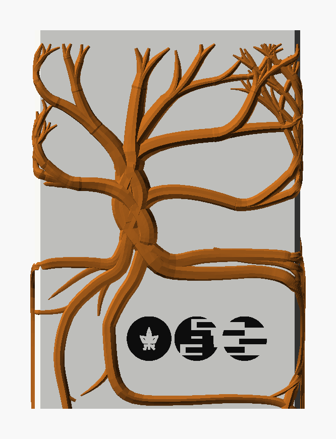
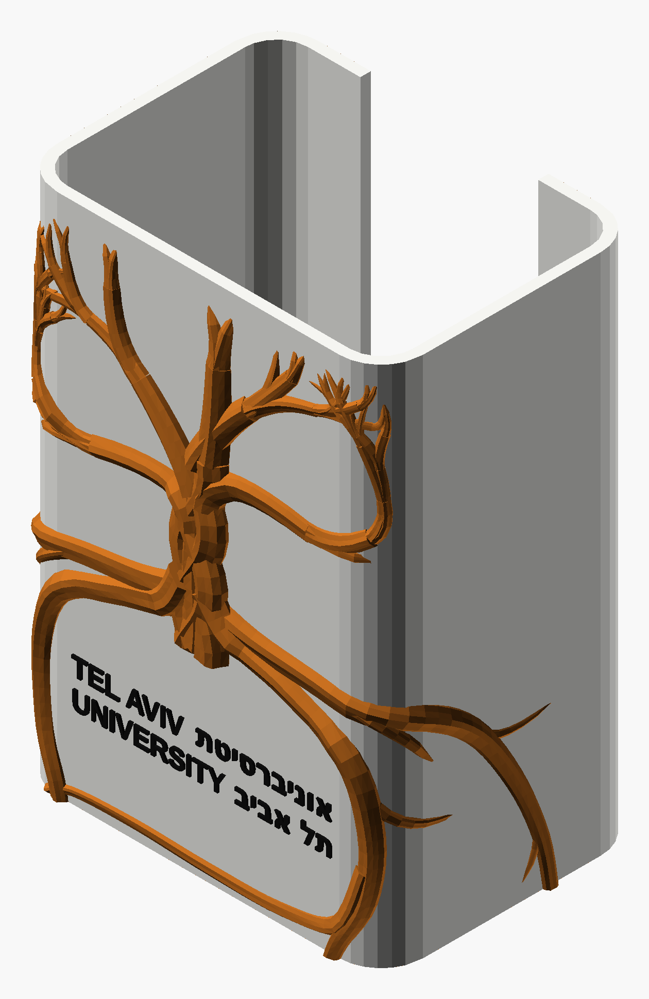
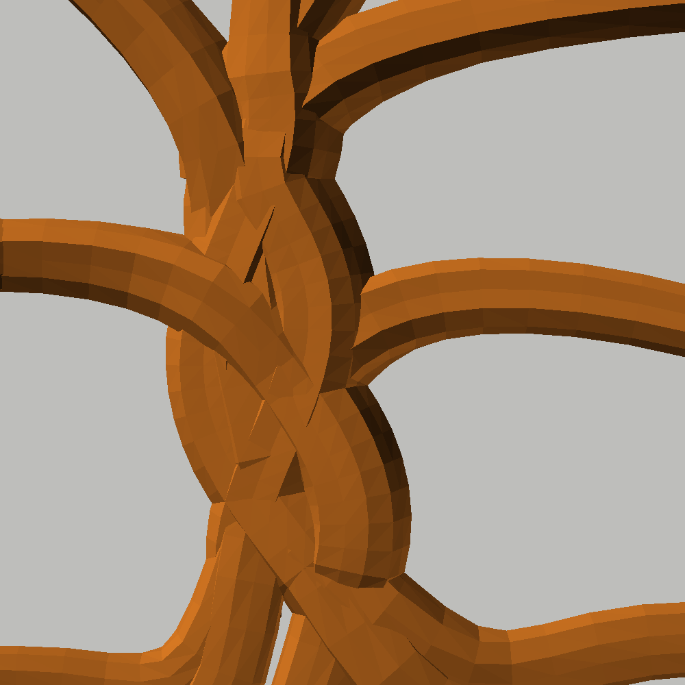

# Rooted Tree Deck Holder

An upright holder for a deck of playing cards, **70 × 50 × 100 mm** (W × D × H), open at the top and
slotted at the back so you can push the deck up with a finger and draw it. It is a plain card box
with square corners and a light 1.5 mm fillet. Laid out after the reference print:
- A tree stands to one side of the front. Its three-strand braided trunk leans out and its crown
  spreads over the whole upper face.
- The roots grow out of the trunk strands and run to both sides. They cross over the plaque, frame
  it, and wrap over both corners onto the sides.
- The plaque carries the faculty's three-disc logo, with no words.

| Front | Isometric |
|---|---|
|  |  |

The images are renders, not photos.

## Sizes

| | mm |
|---|---|
| Outer box | 70 × 50 × 100, corners filleted 1.5 (the relief adds up to 2.8 at the front and 1.5 on the sides) |
| Cavity | 66 × 46 × 98, for 63.5 × 88.9 mm poker cards and a deck up to 44 mm thick |
| Deck top below the rim | 9.1 |
| Back slot | 34 wide, from 28 mm above the bed to the top |
| Walls / floor | 2 / 2 |
| Logo | 37 × 12, inlaid 0.6 and standing 0.4 proud |

## Printing

- Stands on its floor, no supports. Bambu Lab H2C project, 0.20 mm Standard, 35 % infill.
- Three parts, each on its own filament: **Box** Jade White `#FFFFFF`, **Relief** Brown `#9D432C`,
  **Logo** Black `#000000`. Brown is the nearest PLA Basic colour to copper; for the look in the
  reference photo, swap filament 2 to a silk copper in Bambu Studio.
- Every tree member is sunk into the wall by a share of its radius that depends on its direction,
  so no underside is steeper than 58° from vertical. Mesh check: 0 open / non-manifold edges on
  all parts, the relief is one shell, 0.35 % of the surface past 60° above the first centimetre
  (house limit 0.5 %).
- About 62 g at 100 % solid (roughly 19 g at typical infill). Not yet sliced with Bambu Studio:
  the build ran where Bambu Studio is not installed, so check the slice preview before printing.
- The emblem in the first disc is small (about 6 mm tall). `Logo_trace.py` thickens its strokes
  by 0.1 mm a side so they hold at a 0.4 mm nozzle; expect the finest slits to close up.

## How the joints work



- **Strands into limbs.** Each trunk strand and the first limb it feeds are one tube: no joint at all.
- **Forks.** A child starts just inside its parent, 4 % wider than the parent's end and at the same
  depth, then narrows to its own radius over 1.6 radii. The parent runs on a little past the fork,
  tapering inside its children, so no end cap shows.
- **Roots.** The roots start inside their strand, keep just behind its braided depth while they
  are inside it, and swell out of it. The strand and core ends dive into the wall.
- **Bark.** Every ring is laid out from the wall's outward normal, and the bark twist is a function
  of the position on the wall. A parent and a child therefore have the same ring vertices and the
  same ridges where they overlap, with no sawtooth seam. The bark fades out on tips that sink into
  the wall.

## How the corners work

The paths are written on a guide surface with 8 mm corners (`path_r`), so their coordinates keep
their meaning whatever the real fillet is. Round a corner each tube rides a radius of its own: the
largest of its rings' sink depth plus 1.15 × radius. Then no tube bends tighter than itself, and it
stays proud of the squarer real corner. Rings are added where a member crosses a corner, and the
sink is smoothed along each member, so no chord or sink jump cuts a tube under the edge or kinks it.

## Customizer

| Variable | What it does |
|---|---|
| `card_w`, `card_h`, `deck_t`, `side_clear` | The deck; the box is sized from these (the defaults give 70 × 50) |
| `box_h`, `wall`, `floor_t`, `corner_r` | Box height, walls, the fillet on the vertical edges |
| `slot_w`, `slot_bottom` | The back slot |
| `trunk_side` | -1 tree on the left and plaque on the right (default), 1 mirrored |
| `seed` | Grows a different crown and different rootlets |
| `crown_depth`, `limb_len`, `limb_r`, `root_r`, `spread` | Tree size and density |
| `plaque_content` | `logo` (the default, no words), `text`, or `logo_and_text` |
| `logo_file`, `logo_w` | The logo (`Logo.svg`) and its width |
| `line_en1` … `line_he2`, `text_size`, `plaque_layout` | Optional plaque text (English and Hebrew), stacked or side by side |
| `part` | `assembly` to look at; `box`, `relief`, `logo` are the three colour parts |

Any change needs the parts exported again:

```bash
python tools/build_design.py "art/Deck Holders/Rooted Tree Deck Holder/Rooted_Tree_Deck_Holder.scad" \
    --name "Rooted Tree Deck Holder" --out "art/Deck Holders/Rooted Tree Deck Holder" \
    --part box=#FFFFFF --part relief=#9D432C --part logo=#000000
```

## The logo

`Logo.svg` is built from the supplied artwork by `Logo_trace.py` (needs potrace):

```bash
python Logo_trace.py Logo_source.png Emblem_source.png Logo.svg --plaque-w 37
```

- Discs 2 and 3 are traced from `Logo_source.png` (the full logo, white on dark) and clipped to
  ideal circles.
- Disc 1 is an ideal circle with the emblem cut out. The emblem comes from the sharper
  `Emblem_source.png` and is thickened for print.
- If you change `logo_w`, re-run the script with the same `--plaque-w`.
