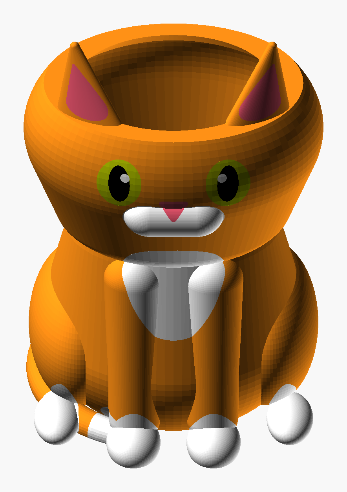

# Kitten Planter

A sitting ginger kitten whose head is a plant pot, open on top between the ears. The whole kitten is
the pot: head and body are one hollow shell with a 3.5 mm wall, so the soil reaches down to the floor
just above the bed.



*The PNG is an OpenSCAD render, not a photo.*

| | |
|---|---|
| Size | 141 × 135 × 200 mm (ear tips at 200 mm, rim at 166 mm) |
| Opening | 60 × 73 mm ellipse |
| Wall / floor | 3.5 mm / 3.5 mm |
| Inside volume | about 1.16 L |
| Drain hole | 10 mm, centred in the floor; stand it on a saucer (`drain_d = 0` makes it a cachepot) |
| Printer | Bambu Lab H2C, 0.20 mm Standard, 35 % sparse infill, no supports |
| Print | 11 h 37 min, 258 g (Bambu Studio slice) |

| Part | Filament (Bambu PLA Basic) | Grams |
|---|---|---|
| Body | Pumpkin Orange `#FF9016` | 222.3 |
| White (muzzle, bib, socks, tail tip, eye highlights) | Jade White `#FFFFFF` | 30.8 |
| Pink (nose, inner ears) | Pink `#F55A74` | 1.9 |
| Eyes | Bright Green `#BECF00` | 1.8 |
| Pupils | Black `#000000` | 1.0 |

## Checks

- Every part: 0 boundary / 0 non-manifold edges. Body 1 shell; white 8 (muzzle, bib, two socks per
  side, the tail tip merged with a front sock, two eye highlights).
- Past 60°: 0.30 % above the bottom 1 cm (limit 0.5 %). The kitten's own surfaces, inside and out, are at
  0.04 %; the rest is the hidden boundaries between colours, which the neighbouring colour supports.
- Bambu Studio slice: no warnings.

## How it prints without supports

- The head is pulled down into a neck cone (a hull of the head and a smaller ellipsoid), so the cheeks
  and chin slope at 45° or more.
- The inside is the same ellipsoids shrunk by the wall. Under the rim, a 45° funnel narrows the inside to
  the opening, so the ears stand on a solid rim and there is no flat ceiling inside.
- The colour patches are flush, cut through the surface. The white socks come to a point up the legs,
  so the colour boundary slopes instead of capping the paw.

## Customizer

`height` (overall size), `wall`, `floor_t`, `drain_d`, the opening `open_rx` / `open_ry`, and the
head, ear and body shapes. After changing any of them, rebuild:

```bash
python tools/build_design.py "art/Sculptures/Kitten Planter/Kitten_Planter.scad" --name "Kitten Planter" --out "art/Sculptures/Kitten Planter" --part body=#FF9016 --part white=#FFFFFF --part pink=#F55A74 --part eyes=#BECF00 --part pupils=#000000
```
