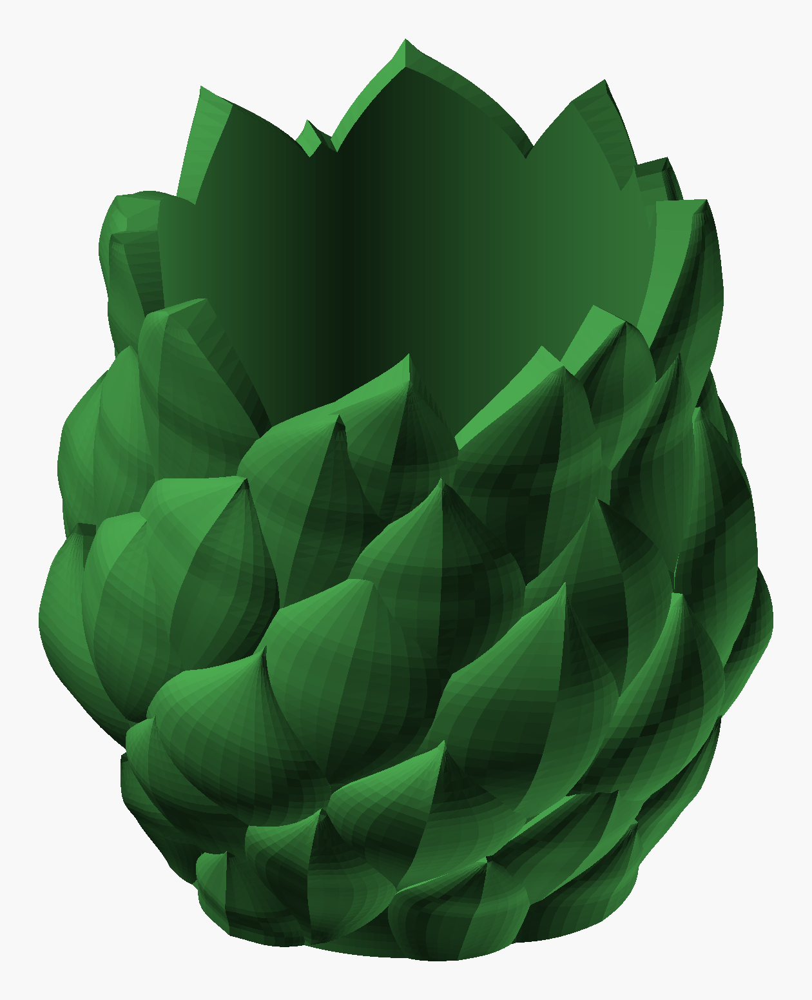

# Spiral Bract Planter

A 20 cm cachepot covered in overlapping bracts, like an artichoke, with two differences. The leaves
sit on a **golden-angle spiral** (137.5° from one leaf to the next) instead of in rows, and **no two
leaves are alike**. Each leaf leans a few degrees the same way round, so the whole body swirls. Near the
top the leaves grow longer and rise above the rim as an open crown.



*The PNG is an OpenSCAD render, not a photo.*

| | |
|---|---|
| Size | 197 × 195 × 202 mm (rim at 165 mm, crown tips up to 202 mm) |
| Opening | 136 mm, straight-sided down to the belly, so a 12–13 cm nursery pot drops in |
| Wall / floor | 4 mm / 4 mm under the leaves |
| Leaves | 56, seed 7 |
| Drain hole | none (cachepot); `drain_d` adds one |
| Printer | Bambu Lab H2C, 0.20 mm Standard, 35 % sparse infill, no supports |
| Print | 16 h 13 min, 880 g (Bambu Studio slice) |
| Filament | Bambu PLA Basic Mistletoe Green `#3F8E43` |

## Checks

- 0 boundary and 0 non-manifold edges, 1 shell.
- Past 60°: 0.00 %. Past 45°: 0.06 %.
- Bambu Studio slice: no warnings.

## How a leaf is made

Each bract is a solid lying on the pot's surface. The pot is a turned body with cosine flanks, a
belly at 78 mm and a vertical collar at the rim. Over its own outline (`u` across, `t` from base to tip),
a leaf has a height field `h(u, t)`: a dome along its length, a cross-section that ranges from pointed
to pillowy, an optional spine down the middle, a raised edge above the shoulder and an outward flare
toward the tip. OpenSCAD draws it as one polyhedron, with its underside buried in the pot wall.

Each leaf has 16 genes: position (`phi`, `z`), size (`L`, `W`), `tilt`, shoulder height `sh`, base
roundness, tip shape, asymmetry, a sideways hook, bulge `H`, cross-section exponent, spine, edge step,
flare and tip thickness.

## Why it prints without supports

- A leaf's lower half fades into the body (`h → 0` at its lower edges), and the tips of the leaves
  below cover it. The raised edge only grows above the shoulder, where the edge faces up.
- Every leaf's shoulder stays below the rim. Above the rim, the crown blades therefore have only
  upward-facing edges. Their inner face is cut by the same cavity as the pot, so it is flush with the
  inside wall.
- The cavity never narrows going up: it follows the wall up to the belly and then stays straight. It
  has no ceiling.

## Leaf workshop: `Spiral_Bract_Planter_leaves.py`

The leaf table in the `.scad` (between `// BEGIN LEAVES` and `// END LEAVES`) comes from this script.
Its shape functions mirror the `.scad`'s, so if you change one, change the other.

```bash
python Spiral_Bract_Planter_leaves.py layout --seed 7 --write   # (re)write the leaf table into the .scad
python Spiral_Bract_Planter_leaves.py sheet --seed 7            # every leaf, flat and shaded -> _leaf_sheet.png
python Spiral_Bract_Planter_leaves.py map --seed 7              # the body unrolled, front leaf wins -> _map.png
python Spiral_Bract_Planter_leaves.py leaf 12                   # one leaf's genes
```

A new `--seed` gives a new planter. The map prints how much of the body below the rim is covered,
which should be about 98 %. The layout settings are at the top of the script: `SPACING` (leaf count),
`L_REF` (leaf size), `ASPECT` (slender to broad), `CROWN` (how much longer the top leaves grow) and
`TOP` (crown height). The gene ranges are in `layout()`.

## Rebuild

After a new seed or a change to the `.scad`:

```bash
python tools/build_design.py "art/Sculptures/Spiral Bract Planter/Spiral_Bract_Planter.scad" --name "Spiral Bract Planter" --out "art/Sculptures/Spiral Bract Planter" --part body=#3F8E43
```

You can also change these Customizer settings: `wall`, `floor_t`, `drain_d`, `inset`, and `sketch`
for fast previews. The body radii and heights (`R0`, `RB`, `RT`, `ZB`, `ZT`) appear in both files,
so change them in both and re-run `layout --write`.
