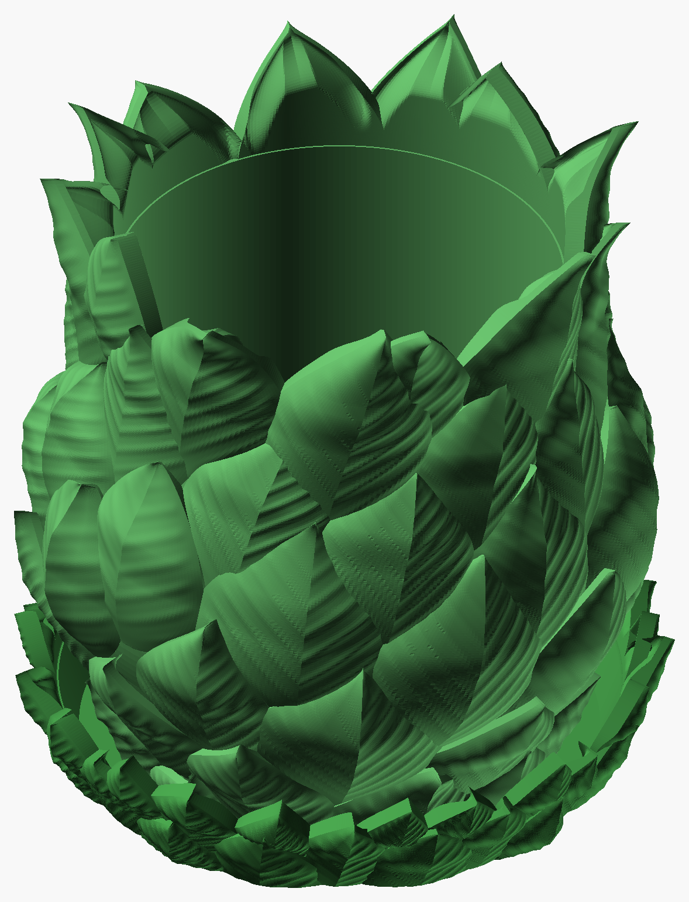

# Spiral Bract Planter

A 20 cm planter covered in overlapping bracts, like an artichoke, with three differences:

- **Spiral, not rows.** The leaves sit on a golden-angle spiral, 137.5° from one leaf to the next.
- **No two leaves alike.** Each leaf has its own shape.
- **Opens like a flower.** The leaves bend open more toward the top, and the crown stands on the
  rim as petals.

A matching leafy saucer catches the water.



*Renders from OpenSCAD, not photos. This is iteration 2; iteration 1 is in [Archive](Archive/).
More views: [from above](Spiral_Bract_Set_Top.png), [low 3/4](Spiral_Bract_Set_Side.png), [close-up of the veins](Spiral_Bract_Set_Closeup.png).*

| | Planter | Saucer |
|---|---|---|
| Size | 195 × 193 × 204 mm (rim at 165 mm) | 198 × 198 × 39 mm (rim at 20 mm) |
| Leaves | 63, seed 7 | 40, seed 3 |
| Inside | 136 mm opening, straight-sided down to the belly | 158 mm floor, 170 mm at the rim, about 360 ml |
| Wall / floor | 4 / 5 mm | 3 / 3 mm |
| Water | 12 mm drain hole, with 3 channels under the floor out to the saucer | watertight shell, leaves outside only |
| Leaf texture | lateral veins, 0.3–0.5 mm | same |
| Print (H2C, 0.20 mm Standard, 35 % infill, no supports) | 17 h 37 min, 897 g | 4 h 02 min, 142 g |
| Filament | Bambu PLA Basic Mistletoe Green `#3F8E43` | same |

The planter stands on the saucer floor. Its foot clears the saucer wall by at least 3.5 mm all the
way up the petals.

## Checks

| | Planter | Saucer |
|---|---|---|
| Open / non-manifold edges | 0 / 0 | 0 / 0 |
| Past 60° above the bottom 1 cm | 0.00 % | 0.01 % |
| Past 45° | 0.68 % | 1.33 % |
| Bambu Studio slice | no warnings | no warnings |
| Sealed voids | 15 tiny ones | 10 |

The sealed voids are internal. Each forms where a neighbouring leaf closes off the mouth of a leaf's
edge lip. The slicer accepts them.

## How a leaf is made

The leaf code is shared between the two pieces, in [Spiral_Bract_leaf.scad](Spiral_Bract_leaf.scad).

Each leaf is **solid from inside the pot wall out to its face**. Its face has two parts:

- **The dome from iteration 1.** It fades to nothing at the base and along the lower edges, has an
  optional midrib spine, and steps up 2.5 mm along the upper edges, where they face up.
- **The leaf's own bend:** a flare toward the tip, a cup or trough across, a twist and a tip curl.

Only a **lip along the upper free edges is hollow**, 2.5 mm thick at the edge. The leaves therefore
read thin where you see their edges.

**What iteration 1 taught.** Solid leaves simply merge where they overlap. The lower leaf always
shows in front, because where its tip crosses the next leaf's base it is the higher of the two. That
leaves no air under the leaves, so nothing passes through anything and nothing starts in mid-air.
Iteration 2's first attempt used thin, free blades. That broke both properties: blades cut through
each other, and the corrections for that left regions the slicer called floating.

## Why it prints without supports

- A leaf's lower edges fade into the body, and it only bends open above its shoulder.
- Each leaf's bend is scaled down until no surface of it hangs past 48° from vertical (house limit
  60°).
- Near the rim each leaf's solid underside reaches down into the wall, stopping 0.6 mm short of the
  inside, so the crown stands on the rim. The leaves' faces stay where they are, so the pot never
  shows between them. The cavity never cuts a leaf, so there are no flat cut faces inside the crown;
  a 0.6 mm step marks the rim.
- The hollow lip along each leaf's upper edges blends into the solid over 2–10 mm, wide enough that
  the mesh doesn't step.
- The planter's cavity never narrows going up, so it has no ceiling. The saucer's wall flares at 20°.

## Leaf workshop: `Spiral_Bract_Planter_leaves.py`

The leaf tables in both `.scad` files (between `// BEGIN LEAVES` and `// END LEAVES`) come from this
script. Its shape functions mirror `Spiral_Bract_leaf.scad`, so if you change one, change the other.

```bash
python Spiral_Bract_Planter_leaves.py layout --write            # planter table (seed 7)
python Spiral_Bract_Planter_leaves.py layout --body saucer --write   # saucer table (seed 3)
python Spiral_Bract_Planter_leaves.py check                     # overhang of every leaf, bend scaling
python Spiral_Bract_Planter_leaves.py sheet                     # every leaf: face, and side profile
python Spiral_Bract_Planter_leaves.py map                       # the body unrolled; bare pot in red
python Spiral_Bract_Planter_leaves.py leaf 12                   # one leaf's genes
```

Add `--body saucer` to any of these to work on the saucer, and `--seed N` for a different set of leaves.

- **Coverage:** the map reports how much of the pot below the rim is covered: 99.5 % on the planter,
  96.8 % on the saucer, where the bare part is slivers at the bed edge.
- **Layout settings:** at the top of the script. `SPACING` sets the leaf count, `L_REF` the leaf
  size, `ASPECT` how broad the leaves are, `CROWN` and `TOP` the crown, `MAX_OVERHANG` the bend
  limit, and the `S_` values the saucer.
- **Gene ranges:** in `make_leaf()`.

**Veins** are on: each leaf has lateral veins running up and out from the midrib, 0.3–0.5 mm high.
The number of veins, their slope and their height are the leaf's own genes. Veins fade out at the
edges, the base and the tip. The overhang budget is worked out without them, so switching them off
(`texture_on = false` in the `.scad`, `TEXTURE = False` in the script) leaves the shape unchanged
and gives a smooth version that renders faster. With veins on, the leaf mesh is about 1.5 times
finer each way, so the veins come out clean.

## Rebuild

```bash
python tools/build_design.py "art/Sculptures/Spiral Bract Planter/Spiral_Bract_Planter.scad" --name "Spiral Bract Planter" --out "art/Sculptures/Spiral Bract Planter" --part body=#3F8E43
```

```bash
python tools/build_design.py "art/Sculptures/Spiral Bract Planter/Spiral_Bract_Saucer.scad" --name "Spiral Bract Saucer" --out "art/Sculptures/Spiral Bract Planter" --part body=#3F8E43
```

**Customizer settings:**
- Planter: `wall`, `floor_t`, `drain_d` (0 makes it a cachepot), `channels`, `edge_t`, and `sketch`
  for fast previews.
- Saucer: `rf`, `wall`, `floor_t`, `ZT`, `flare`.

The body sizes appear in both the `.scad` and the script. Change them in both places and re-run
`layout --write`.
