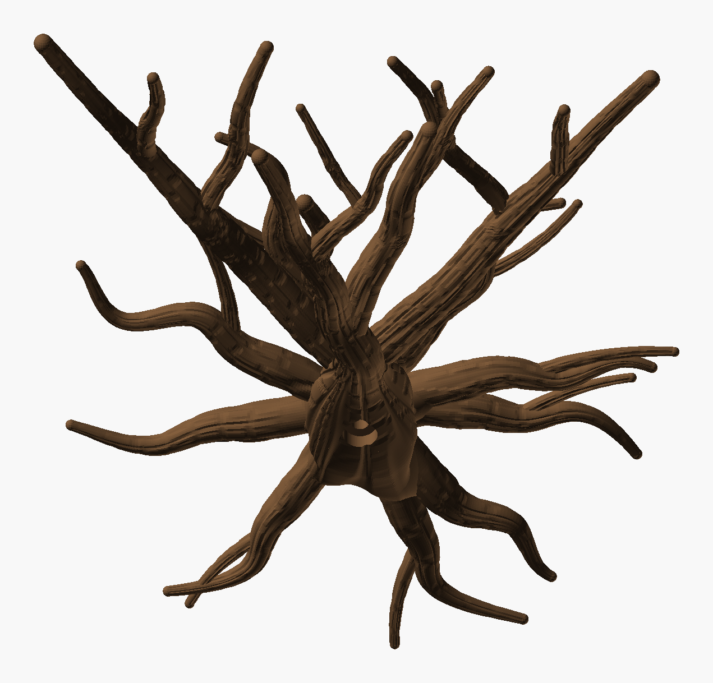
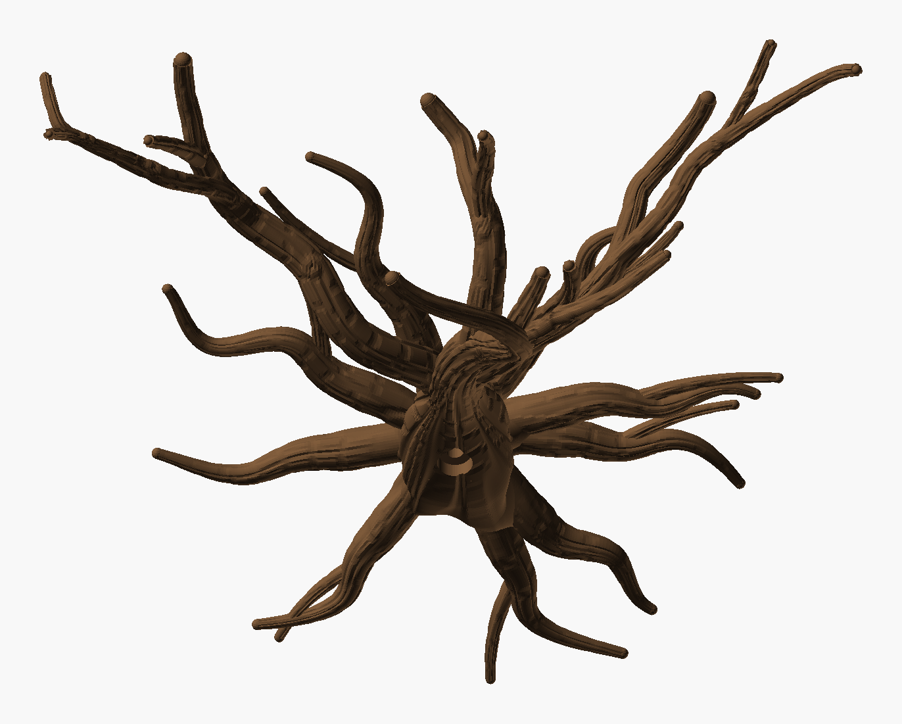

# Wall Climber Tree: archive

The iterations that led to the [main design](../README.md) (iteration 7). Their build commands
now point into `Archive/`.

A tree that grows out of the wall, for climbing and sprawling plants. It comes in two parts: a
roots plate that prints flat, and a tree that prints standing, slides onto the plate and clamps it
to the wall with one 6 mm screw.

| Iteration | Crown | Roots | Tree part |
|---|---|---|---|
| [iteration_1](iteration_1/README.md) | 3 → 7, tips spread along the wall | 9 roots, evenly fanned | 215 × 86 × 184 mm, 53 g |
| [iteration_2](iteration_2/README.md) | 3 → 7 → 13, sprawling in all directions, branches ending at different lengths | as iteration 1 | 186 × 95 × 187 mm, 65 g |
| [iteration_3](iteration_3/README.md) | 3 → 7 → 13, new random draw; branches swirl, wind round each other and grow together where they meet | new random draw (`root_seed` 2), bunched and crossing | 161 × 96 × 185 mm, 63 g |
| [iteration_4](iteration_4/README.md) | 3 → 7 → 13, forks leave along their parent and are clearly thinner; wider and sprawlier (tips span 206 mm) | as iteration 3 | 212 × 112 × 183 mm, 62 g |
| [iteration_5](iteration_5/README.md) | 3 → 7 → 13, zigzag branches, 6 meetings; the step at the leader's base and the fork creases patched | as iteration 3 | 213 × 129 × 184 mm, 65 g |
| [iteration_6](iteration_6/README.md) | strict 3 → 7 → 13, stronger zigzag, wider (tips span 217 mm), 4 meetings; fork rings removed, forks capped thinner than their parent | as iteration 3 | 223 × 95 × 186 mm, 68 g |
| [iteration_7 (main)](../README.md) | 3 → 7 → 13 grown, not aimed: main branches bend and twist in any direction, back towards the wall too, printed to 60° (climb ≥ 32°); tips span 281 mm | as iteration 3 | 285 × 142 × 183 mm, 69 g |

All iterations share the Wild-Chaotic-Tree-style burl, buttresses and bark, and the slide and
screw.

| Iteration 1 | Iteration 2 |
|---|---|
|  |  |

| Iteration 3 | Iteration 4 |
|---|---|
|  |  |

| Iteration 5 | Iteration 6 |
|---|---|
|  |  |

| Iteration 7 | |
|---|---|
|  | |
