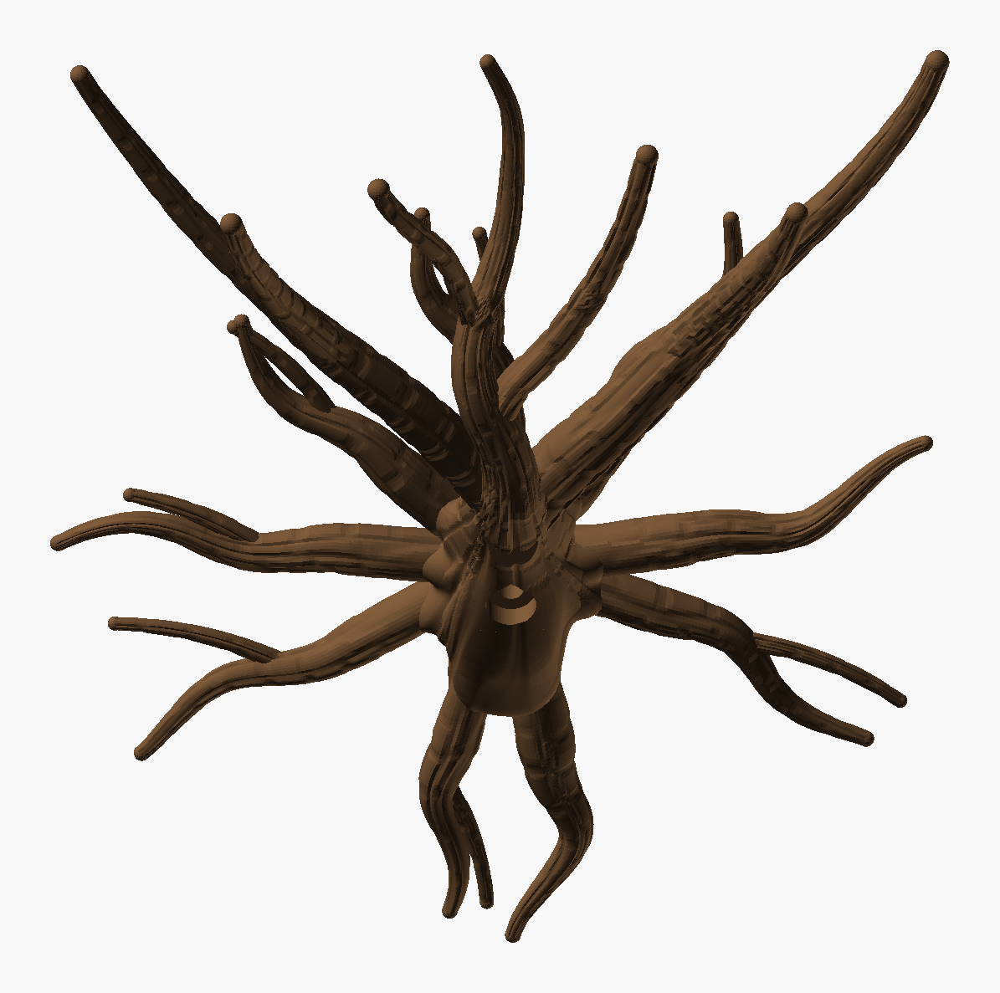
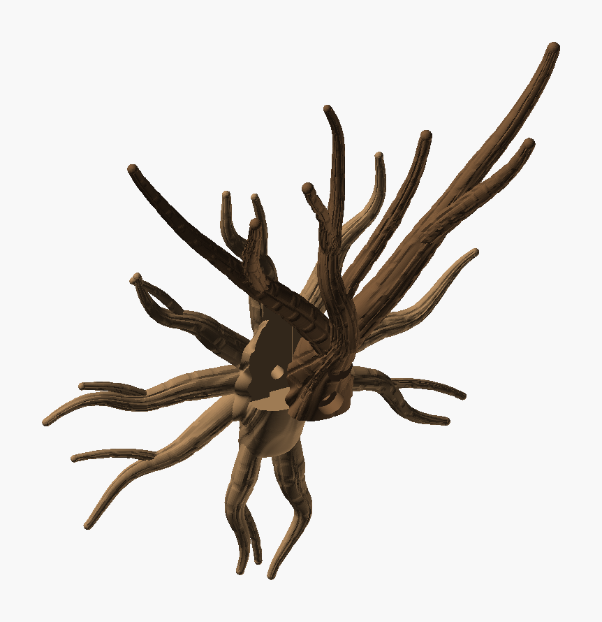
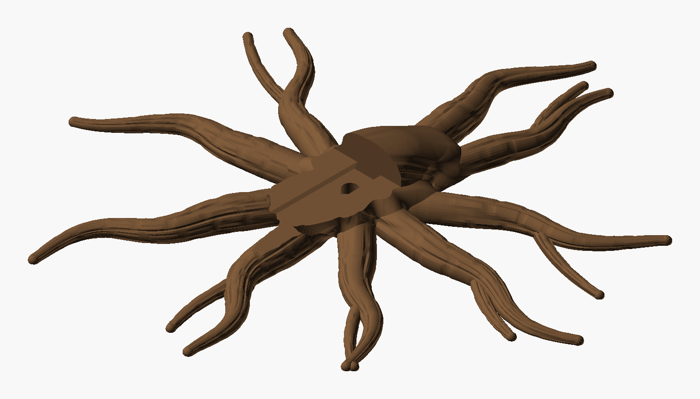

# Wall Climber Tree — iteration 1

A tree that grows out of the wall, for climbing and sprawling plants to wind through. The trunk
leaves the wall from a buttressed burl and carries on as a leader. Two limbs part from it just
above the burl, and the three split into **7 tips** that sprawl up to **150 mm above the first
parting**. Roots crawl out of the burl over the wall in every direction, meandering and forking.
Everything wears bark.



*The PNGs are OpenSCAD renders, not photos.*

The base follows the
[Wild Chaotic Tree](../../../Tree%20Vase/Wild%20Chaotic%20Tree/Wild_Chaotic_Tree.scad):

- **One skin:** the burl is a single surface, the smooth maximum of:
  - the trunk's section;
  - a buttress ridge running out along every root;
  - a copy of each root's base.

  The roots therefore come out of a fillet under their buttress, not out of a seam.
- **One bark:** trunk, burl and the roots' bases share one bark, fixed in space round the trunk
  axis, so the fissures run continuously up the trunk, down the buttresses and out along the
  roots. Past their buttress the roots blend into their own bark; the trunk does the same once it
  bends up into the crown.
- **The roots themselves** taper, sweep to one side, meander more as they go and fork side roots.

It is **two parts that slide together**. The burl is one surface split by a plane parallel to the
wall, so both halves have the same outline where they meet.



| Part | File | Prints | Size on the bed | Slice (H2C, 35 % infill) |
|---|---|---|---|---|
| **Roots**: wall side, back of the burl and all the roots | `Wall_Climber_Tree_Roots.3mf` | **flat on its back** | 216 × 220 × 24 mm | 1 h 42 min, 51 g |
| **Tree**: front of the burl, trunk and crown | `Wall_Climber_Tree.3mf` | **standing**, as it hangs | 215 × 86 × 184 mm | 2 h 48 min, 53 g |

Both use Cocoa Brown `#6F5034` (Bambu PLA Basic). Neither needs supports.



**Assembled:** 220 mm wide, 95 mm out from the wall, 293 mm tall. The roots reach 78 mm below the
trunk's base, and the crown reaches 215 mm above it.

## Assembly

1. Hold the roots against the wall.
2. Slide the tree down from about 3 cm above. The dovetail tongue on its back goes into the groove
   in the roots, and its foot comes to rest on the burl's shelf. That lines the two screw holes up.
3. Drive a **6 mm screw** (6 × 50 mm or longer, with a wall plug) from the front, through the knot
   hole under the trunk. It passes through the tree and the roots into the wall, so **the tree
   clamps the roots against the wall**.

## Checks

| | Tree | Roots |
|---|---|---|
| Topology | 1 shell, 0 / 0 edges | 1 shell, 0 / 0 edges |
| Past 60° | 0.00 % | 0.01 % (0.06 % in the bottom 1 cm) |
| Bed contact | 3.5 cm² (foot + tongue) | 92 cm² |
| Floating regions | 0 (`floating_check.py` and Bambu Studio) | 0 |
| Crown | climb ≥ 45.4° everywhere, 3.7 mm clear between branches, tips ≥ 35 mm apart | — |

- **Fit** (`Wall_Climber_Tree_check.py`): the parts only touch where they meet (0 mm³ overlap). The
  tree also slides in from 35 mm above without touching anything.
- **The tree stands 184 mm tall on a 3.5 cm² foot**, with its crown leaning out over it. Use
  Bambu Studio's brim.

## Working on it

| File | What it does |
|---|---|
| `Wall_Climber_Tree.scad` | The design: burl, buttresses, roots, bark, the slide and screw, both parts |
| `Wall_Climber_Tree_layout.py` | Searches the crown and writes `Wall_Climber_Tree_layout.scad`: the trunk/leader, 2 limbs and 4 forks as paths and radii. It rejects any crown that climbs under 45° anywhere, comes within 2.5 mm of itself, or rises over 150 mm above the first parting. **`python Wall_Climber_Tree_layout.py 11 3000` reproduces the crown in the package** (best of seeds 3, 7, 11, 19); another seed gives another tree |
| `Wall_Climber_Tree_layout.scad` | Generated; the `.scad` includes it and asserts it was made for the same trunk |
| `Wall_Climber_Tree_check.py` | Fit and slide of the two parts, and floating regions in each as printed (about 3 min; `--draft` is faster) |

Customizer:

- **Roots:** `root_count`, `root_reach`, `root_r0` (1.35 × it must stay under `split_y`),
  `root_meander`, `root_sweep`, `side_roots`.
- **Buttresses:** `buttress`, `buttress_h`.
- **Bark:** `bark_depth`, `plate_w`, `plate_len`.
- **Burl and slide:** `flare`, `lobe`, `lobe_w`, and the screw and slide sizes.

Changing the trunk (`trunk_z`, `trunk_climb`, `burl_h`, `trunk_r`) needs the layout script re-run
with the same numbers.

Rebuild both parts, then check:

```bash
python tools/build_design.py "art/Sculptures/Wall Climber Tree/Archive/iteration_1/Wall_Climber_Tree.scad" --name "Wall Climber Tree" --out "art/Sculptures/Wall Climber Tree/Archive/iteration_1" --part tree=#6F5034
```

```bash
python tools/build_design.py "art/Sculptures/Wall Climber Tree/Archive/iteration_1/Wall_Climber_Tree.scad" --name "Wall Climber Tree Roots" --out "art/Sculptures/Wall Climber Tree/Archive/iteration_1" --part roots=#6F5034 --define part=\"roots\"
```

```bash
python "art/Sculptures/Wall Climber Tree/Archive/iteration_1/Wall_Climber_Tree_check.py"
```
