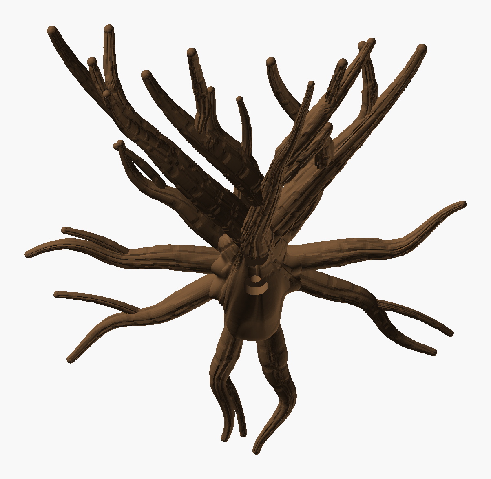
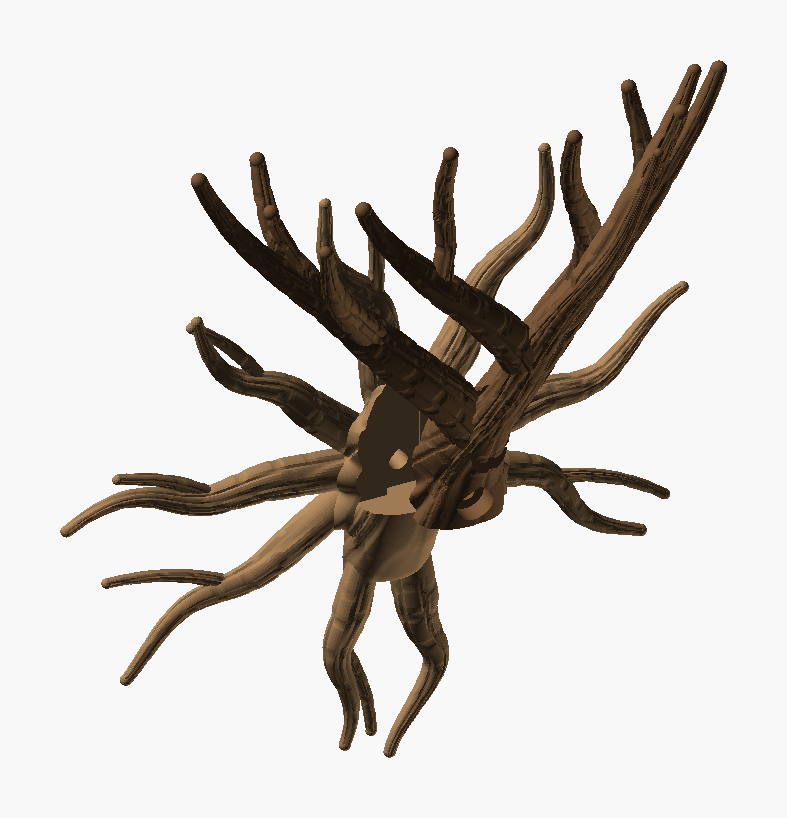

# Wall Climber Tree — iteration 2

[Iteration 1](../iteration_1/README.md) with a fuller, more sprawling crown. The base, roots,
bark, slide and screw are unchanged.

- **3 → 7 → 13.** The trunk carries on as a leader, and two limbs part from it just above the
  burl. Four forks (two off the leader, one off each limb) make 7 branches, and six of those fork
  once more, giving **13 tips**.
- **Sprawling in all directions.** Each fork heads off at its own azimuth: sideways along the
  wall, out from it, or back towards it where there is room. Each also has its own climb (52–76°).
  The tips span 181 mm along the wall and 17–102 mm out from it.
- **Branches end at different lengths.** Fork length shrinks with the level (125–165, 75–125 and
  40–85 mm), and forks high in the crown end shorter. Members run from 37 to 214 mm long, and the
  tips end between 162 and 215 mm up, all within 150 mm above the first parting.



*The PNGs are OpenSCAD renders, not photos.*



| Part | File | Prints | Size on the bed | Slice (H2C, 35 % infill) |
|---|---|---|---|---|
| **Roots** | `Wall_Climber_Tree_Roots.3mf` | flat on its back | 216 × 220 × 24 mm | 1 h 42 min, 51 g |
| **Tree** | `Wall_Climber_Tree.3mf` | standing, as it hangs | 186 × 95 × 187 mm | 3 h 24 min, 65 g |

Both use Cocoa Brown `#6F5034` (Bambu PLA Basic). Neither needs supports. Assembly is as in
iteration 1:

1. Hold the roots against the wall.
2. Slide the tree down until its foot sits on the burl's shelf.
3. Drive a 6 mm screw (6 × 50 mm or longer, with a wall plug) through the knot hole under the trunk.

## Checks

| | Tree | Roots |
|---|---|---|
| Topology | 1 shell, 0 / 0 edges | 1 shell, 0 / 0 edges |
| Past 60° | 0.06 % | 0.01 % |
| Bed contact | 3.5 cm² | 92 cm² |
| Floating regions | 0 (`floating_check.py` and Bambu Studio) | 0 |
| Crown | climb ≥ 45.9°, 4.3 mm clear between branches, tips ≥ 22.7 mm apart | — |

- **Fit:** 0 mm³ overlap, and the tree slides in from 35 mm above without touching anything.
- **The tree stands 187 mm on a 3.5 cm² foot**, so use Bambu Studio's brim.

## Working on it

- **Sketch mode.** Set `sketch = true` (or pass `-D sketch=true`) for no bark and coarse sampling.
  Paths, radii and joins stay the same; a preview takes about 12 s against about 60 s with bark.
  Find the shape in sketch mode, then build with bark.
- **`Wall_Climber_Tree_layout.py`** grows the crown member by member. Each fork tries up to 25
  candidate tips, and the first that climbs at least 45°, stays off the wall and clears the
  branches already there is kept. The whole tree is then checked again with the final radii.
  - About 0.6 % of grown trees pass. Of the passing trees, the one with its tips furthest apart
    and spread over the most volume wins.
  - **`python Wall_Climber_Tree_layout.py 6 4000` reproduces this crown.** It was the best of
    seeds 1, 3, 5, 6, 8 and 9 (2.5 min each); another seed gives another tree.
- **`Wall_Climber_Tree_check.py`** checks the fit and slide and the floating regions.
  `--sketch` makes it faster, for the shape only.

Rebuild both parts, then check:

```bash
python tools/build_design.py "art/Sculptures/Wall Climber Tree/Archive/iteration_2/Wall_Climber_Tree.scad" --name "Wall Climber Tree" --out "art/Sculptures/Wall Climber Tree/Archive/iteration_2" --part tree=#6F5034
```

```bash
python tools/build_design.py "art/Sculptures/Wall Climber Tree/Archive/iteration_2/Wall_Climber_Tree.scad" --name "Wall Climber Tree Roots" --out "art/Sculptures/Wall Climber Tree/Archive/iteration_2" --part roots=#6F5034 --define part=\"roots\"
```

```bash
python "art/Sculptures/Wall Climber Tree/Archive/iteration_2/Wall_Climber_Tree_check.py"
```
