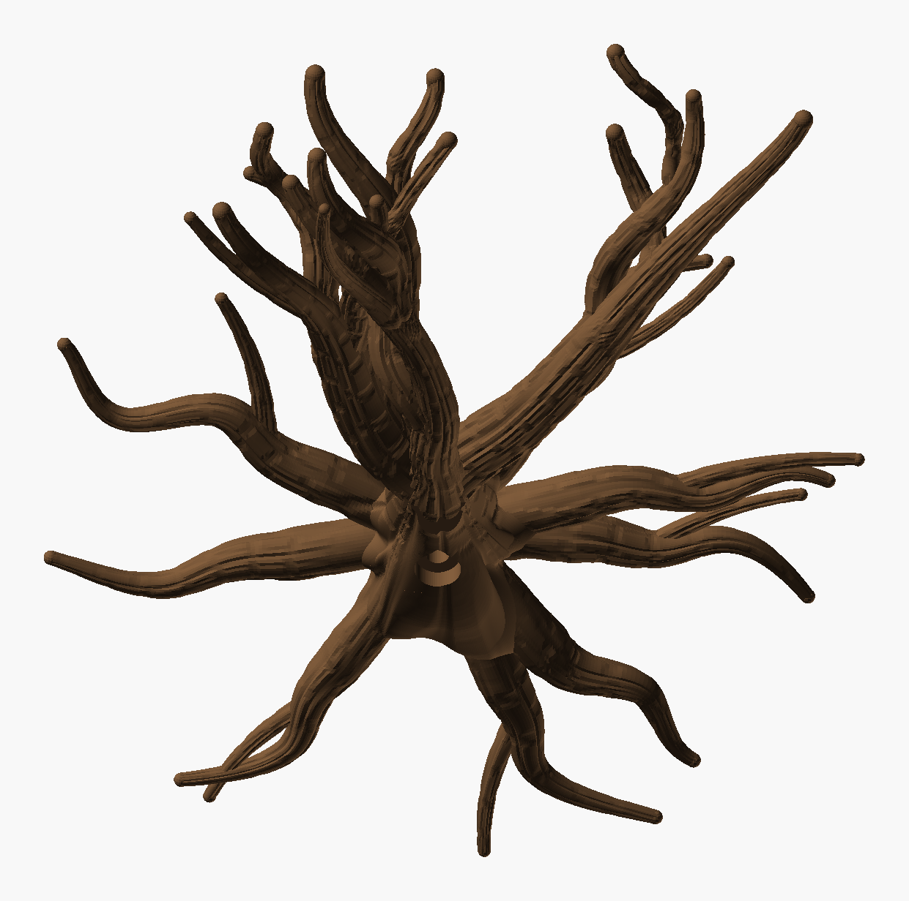
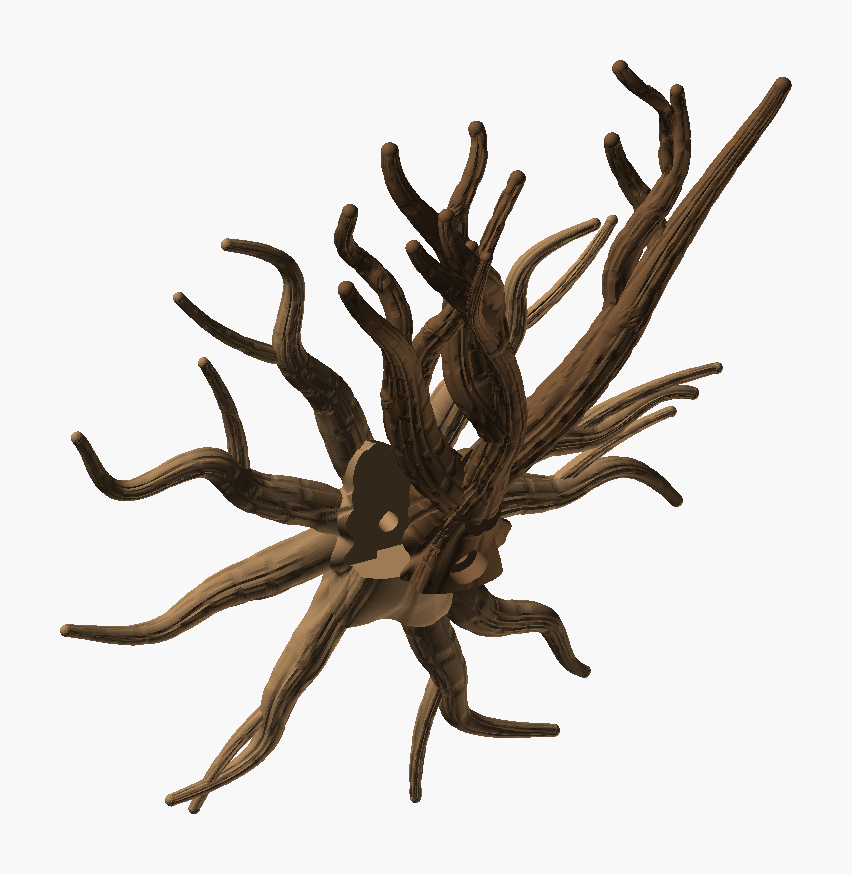
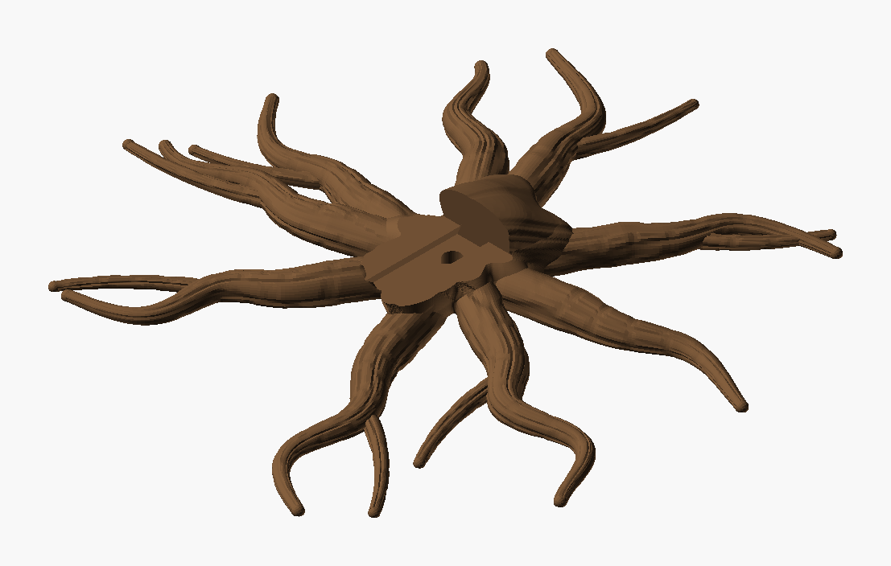

# Wall Climber Tree — iteration 3

[Iteration 2](../iteration_2/README.md) with the roots and the crown both drawn afresh at random,
and branches that bend, swirl and tangle. The burl, buttresses, bark, slide and screw are unchanged.

- **New random roots** (`root_seed = 2`). Every random draw for the roots goes through the seed:
  angle, thickness, length, buttress, sweep, meander and side roots.
  - The angles come from random gaps (0.45–1.45 of an even share each), so the roots bunch and
    part irregularly instead of fanning evenly.
  - Each root meanders by its own amount (0.6–1.4 × `root_meander`) over its own wavelength.
  - Seeds 2–7 were compared side by side; 2 has the most irregular, crossing roots.
- **New random crown**, still 3 → 7 → 13 with branches of different lengths (45–216 mm, tips at
  183–213 mm).
- **Swirled and entangled:**
  - **Swirl:** every branch spirals round its own line, 0.6–1.6 turns. Each branch's swirl radius
    is sized from the climb it can spare, so it still climbs at least 45° and prints standing.
  - **Winding together:** a fork swirls the opposite way to its parent, so the two wind round each
    other.
  - **Meetings:** where branches cross they grow together, as in the Chaotic Cradle Tree. Each
    sinks into the other by at most 30 % of the thinner one's thickness, over at most 18 mm. This
    crown has 4 meetings (merge ≤ 24 %), which also ties it into a stiffer print.



*The PNGs are OpenSCAD renders, not photos.*



| Part | File | Prints | Size on the bed | Slice (H2C, 35 % infill) |
|---|---|---|---|---|
| **Roots** | `Wall_Climber_Tree_Roots.3mf` | flat on its back | 220 × 226 × 24 mm | 1 h 53 min, 55 g |
| **Tree** | `Wall_Climber_Tree.3mf` | standing, as it hangs | 161 × 96 × 185 mm | 3 h 14 min, 63 g |

Both use Cocoa Brown `#6F5034` (Bambu PLA Basic). Neither needs supports. Assembly is as before:

1. Hold the roots against the wall.
2. Slide the tree down until its foot sits on the burl's shelf.
3. Drive a 6 mm screw (6 × 50 mm or longer, with a wall plug) through the knot hole under the trunk.



## Checks

| | Tree | Roots |
|---|---|---|
| Topology | 1 shell, 0 / 0 edges (the merges fuse cleanly) | 1 shell, 0 / 0 edges |
| Past 60° | 0.01 % | 0.01 % |
| Bed contact | 3.4 cm² | 102 cm² |
| Floating regions | 0 (`floating_check.py` and Bambu Studio) | 0 |
| Crown | climb ≥ 45.5°, 4 meetings (merge ≤ 24 %), tips ≥ 18.5 mm apart, spanning 156 mm along the wall | — |

- **Fit:** 0 mm³ overlap, and the tree slides in from 35 mm above without touching anything.
- **The tree stands 185 mm on a 3.4 cm² foot**, so use Bambu Studio's brim.

## Working on it

- **Sketch mode** (`-D sketch=true`): no bark, about 12 s a preview.
- **New roots:** try other `root_seed` values and compare them in sketch mode.
- **New crown:** **`python Wall_Climber_Tree_layout.py 11 3000` reproduces this crown.** It was the
  best of seeds 11–16 (3 min each, about 3 % of grown trees pass).
  - **Score:** tip spacing and spread, plus 6 points per meeting (up to 10).
  - **Spread rule:** the tips must span at least 150 mm along the wall. Rewarding meetings alone
    bunched the first pick to one side (tips from x −74 to +33).
- **`Wall_Climber_Tree_check.py`** checks the fit, the slide and the floating regions.

Rebuild both parts, then check:

```bash
python tools/build_design.py "art/Sculptures/Wall Climber Tree/Archive/iteration_3/Wall_Climber_Tree.scad" --name "Wall Climber Tree" --out "art/Sculptures/Wall Climber Tree/Archive/iteration_3" --part tree=#6F5034
```

```bash
python tools/build_design.py "art/Sculptures/Wall Climber Tree/Archive/iteration_3/Wall_Climber_Tree.scad" --name "Wall Climber Tree Roots" --out "art/Sculptures/Wall Climber Tree/Archive/iteration_3" --part roots=#6F5034 --define part=\"roots\"
```

```bash
python "art/Sculptures/Wall Climber Tree/Archive/iteration_3/Wall_Climber_Tree_check.py"
```
