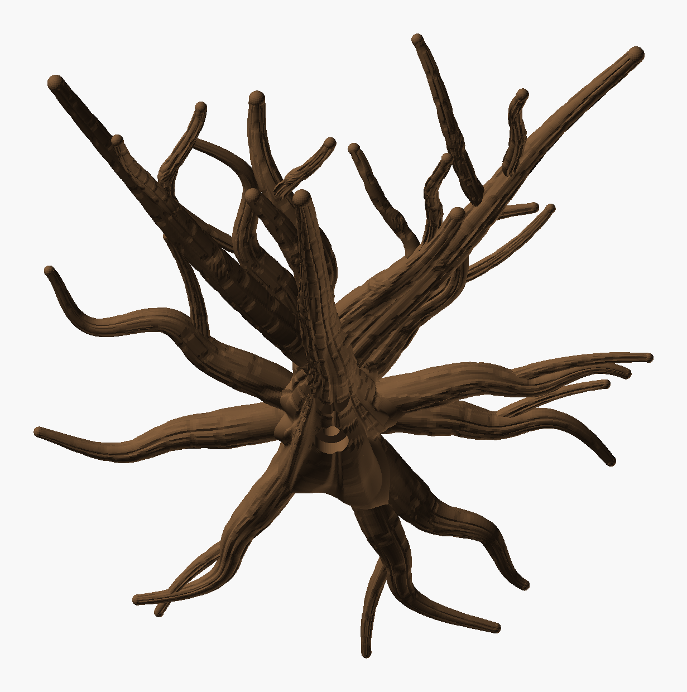
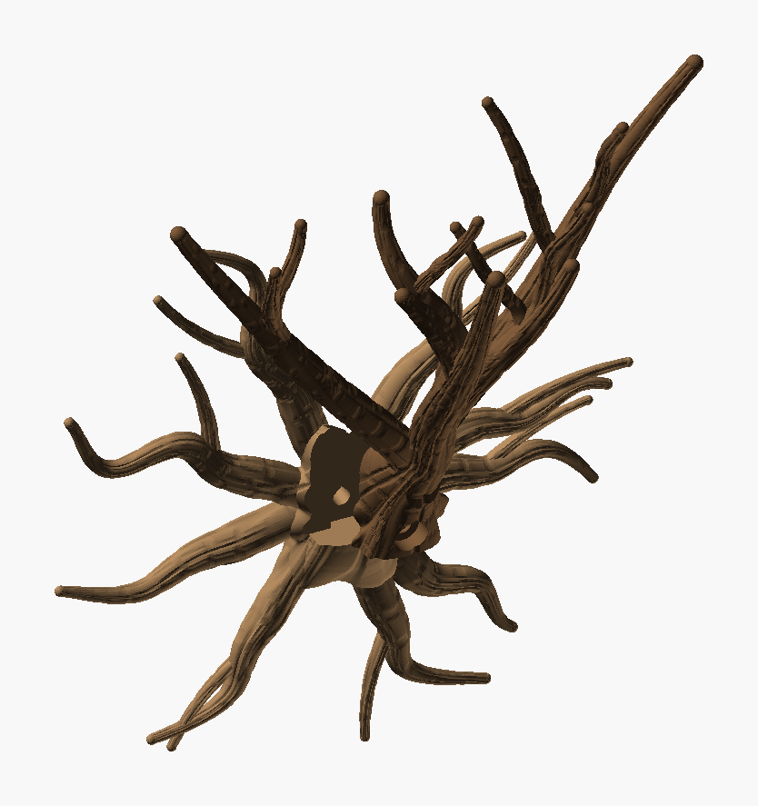

# Wall Climber Tree — iteration 4

[Iteration 3](../iteration_3/README.md) with smoother forks, branches clearly thinner than what
they leave, and a wider, sprawlier crown. The roots (`root_seed` 2), burl, bark, slide and screw
are unchanged.

- **Smoother forks.**
  - Each fork leaves close along its parent, within about 20°, and peels away over about a fifth
    of its length. The crotches are long and narrow, and a fork comes out of its parent along a
    shallow seam instead of a crease.
  - A fork starts thinner than its parent minus 1 mm, so it stays hidden inside the parent while
    they run together. Iteration 3's forks swelled from inside the parent instead.
  - Forks only leave a member past its own joint (its first half). Earlier forks left from a limb
    that was still peeling off the leader, which made tangled junctions.
- **Thinner branches.** A fork takes 60–64 % of its parent's radius (iteration 3: 66–80 %) and
  never more than the parent minus 1 mm. The trunk and leader stay the thickest; every step out
  is visibly thinner.
- **More sprawl.**
  - The tips span 206 mm along the wall (x −108 to +98, against 156 mm in iteration 3) and
    22–117 mm out from it, between 162 and 211 mm up. Tips are at least 35 mm apart (18.5 mm in
    iteration 3).
  - Each fork heads wherever, among the candidates that pass every check, its tip lands
    furthest from the others.
  - The limbs are longer (177–187 mm).
- **Still swirled,** a little less entangled: 2 meetings (merge ≤ 9 %).
- **A clean base.** Where the burl hands over to the trunk, the trunk's fissures used to stop in
  knife-edged scallops against the burl's smoother bulge. Two differences caused it:
  - The burl cut its bark in along the wall plane, the trunk along its own normal.
  - The burl's cross-cracks faded from 2 mm beyond the trunk.

  Now the burl cuts its bark along the trunk's normal once past the roots, the cracks fade only
  from 6 mm out, and the burl sinks under the trunk at a steady 16°. The fissures run on
  unbroken.



*The PNGs are OpenSCAD renders, not photos.*



| Part | File | Prints | Size on the bed | Slice (H2C, 35 % infill) |
|---|---|---|---|---|
| **Roots** | `Wall_Climber_Tree_Roots.3mf` | flat on its back | 220 × 226 × 24 mm | 1 h 53 min, 55 g |
| **Tree** | `Wall_Climber_Tree.3mf` | standing, as it hangs | 212 × 112 × 183 mm | 3 h 21 min, 62 g |

Both use Cocoa Brown `#6F5034` (Bambu PLA Basic). Neither needs supports. Assembly is unchanged:

1. Hold the roots against the wall.
2. Slide the tree down until its foot sits on the burl's shelf.
3. Drive a 6 mm screw (6 × 50 mm or longer, with a wall plug) through the knot hole under the trunk.

## Checks

| | Tree | Roots |
|---|---|---|
| Topology | 1 shell, 0 / 0 edges | 1 shell, 0 / 0 edges |
| Past 60° | 0.00 % | 0.01 % |
| Bed contact | 3.4 cm² | 102 cm² |
| Floating regions | 0 (`floating_check.py` and Bambu Studio) | 0 |
| Crown | climb ≥ 46.1°, 2 meetings (merge ≤ 9 %), tips ≥ 34.6 mm apart | — |

- **Fit:** 0 mm³ overlap, and the tree slides in from 35 mm above without touching anything.
- **The tree stands 183 mm on a 3.4 cm² foot**, so use Bambu Studio's brim.

## What was tried and dropped

**A branch collar:** forks starting as thick as the parent allows and narrowing over 22 mm, to
fill the crotch like a fillet. A fork starts tilted about 20° off its parent's axis, so a collar
that thick poked out of the parent within millimetres of its start. The result was visible
sleeves at the crotches, 8 regions starting in mid-air and 0.57 % overhang. A true fillet would
need a smooth union, which tubes cannot give.

## Working on it

- **Sketch mode** (`-D sketch=true`): no bark, about 12 s a preview.
- **`Wall_Climber_Tree_layout.py`** grows the crown member by member.
  - **`python Wall_Climber_Tree_layout.py 33 240` reproduces this crown.** It was the best of
    seeds 31–36, about 8 min each; roughly half the grown trees pass.
  - Its `WHY` counter records why every fork candidate was turned down: no tip, climb, wall,
    meeting or parent too thin. That is how this iteration's search was tuned.
- **`Wall_Climber_Tree_check.py`** checks the fit, the slide and the floating regions.

Rebuild both parts, then check:

```bash
python tools/build_design.py "art/Sculptures/Wall Climber Tree/Archive/iteration_4/Wall_Climber_Tree.scad" --name "Wall Climber Tree" --out "art/Sculptures/Wall Climber Tree/Archive/iteration_4" --part tree=#6F5034
```

```bash
python tools/build_design.py "art/Sculptures/Wall Climber Tree/Archive/iteration_4/Wall_Climber_Tree.scad" --name "Wall Climber Tree Roots" --out "art/Sculptures/Wall Climber Tree/Archive/iteration_4" --part roots=#6F5034 --define part=\"roots\"
```

```bash
python "art/Sculptures/Wall Climber Tree/Archive/iteration_4/Wall_Climber_Tree_check.py"
```
