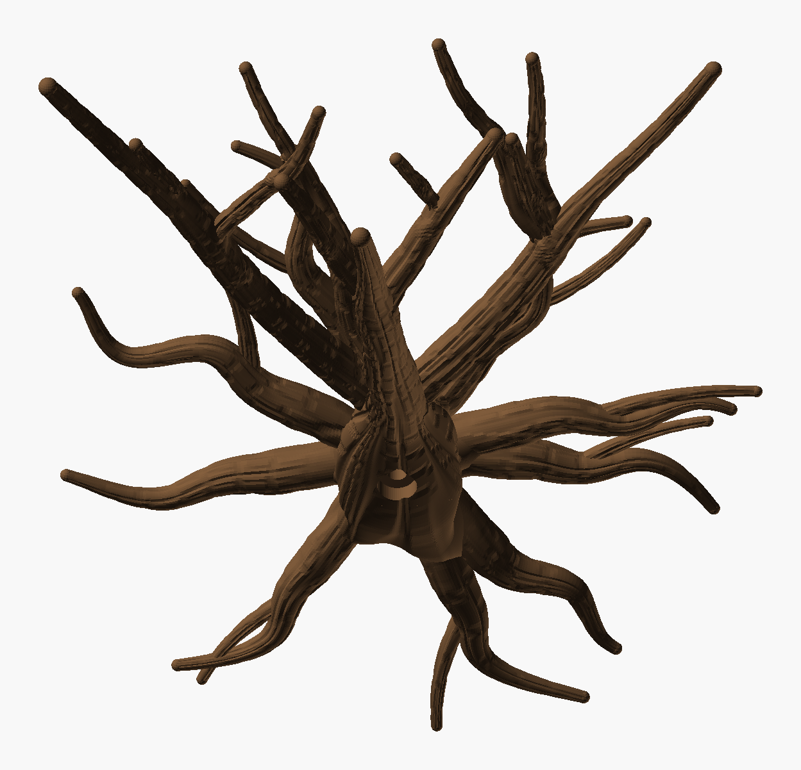
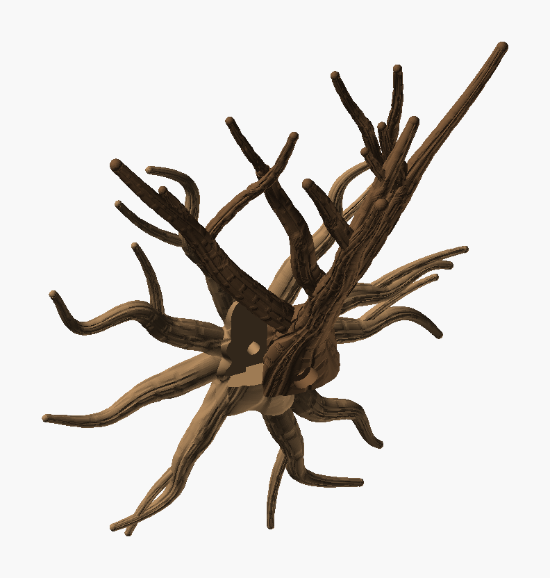

# Wall Climber Tree — iteration 5

[Iteration 4](../iteration_4/README.md) with its joints patched, the step at the base of the
middle branch gone, and branches that zigzag and tangle. The roots (`root_seed` 2), slide and
screw are unchanged.



*The PNGs are OpenSCAD renders, not photos.*

## The connections

All of this was found and fixed in sketch mode (no bark), by cutting the first parting out of
the model with a box and rendering it from four sides, one component at a time. That is
`Wall_Climber_Tree_inspect.scad`, which is in this folder.

- **The step at the base of the middle branch** (the crescent round the leader where it leaves
  the burl) had a different cause from what it looked like:
  - **Cause:** the trunk thins where the two limbs part from it (forks thin their parent so the
    cross-sections add up), and that happens inside the burl. The burl modelled the trunk at its
    full 11 mm right up to its end. So the burl's end ring stood up to 1.7 mm proud of the thinned
    trunk.
  - **Fix:** the burl now reads the trunk's real radius from the layout at each point, and lies
    0.05 mm outside it, parallel, never crossing it, so there is no crease.
  - **Dead ends:** keeping the burl 0.4 mm proud and sinking it under the trunk left a step;
    keeping it inside the trunk left a crease where the keel dipped under.
- **The burl's rings glide onto the trunk axis** above the roots, instead of keeping a fixed
  offset. Where the trunk has thinned, the offset ring centres fell outside the trunk's section.
- **Fork fillets.** Each branch's rings include a copy of every fork leaving it, merged with a
  smooth maximum (after the Wild Chaotic Tree's limb circles). The V-groove where two tubes cross
  becomes a fillet, and the copy fades as the fork's centre leaves the parent.
- **The leader has no kink.** It now leaves the trunk's straight part exactly along it.
  Iteration 4's tilted fork start had kinked it by about 20° there, which left a crease ring.

## The branches

- **Zigzag.** A branch no longer follows one smooth curve. It runs through 1–4 bend points, one
  per 30–50 mm, that swing alternately to either side of its line, in a plane of its own, joined
  by a smooth spline. The swirl stays on top. Both are sized from the climb the branch can spare,
  so every branch still climbs at least 45° (45.3° minimum) and prints standing.
- **More tangled.** When a fork chooses its direction, crossing another branch now counts in its
  favour as well as spreading out. This crown has **6 meetings** where branches grow together
  (merge ≤ 17 %); iteration 4 had 2.
- **Still wide:** the tips span 208 mm along the wall (x −99 to +109), reach 30–134 mm out from
  it and stand 178–212 mm up, at least 30 mm apart.



| Part | File | Prints | Size on the bed | Slice (H2C, 35 % infill) |
|---|---|---|---|---|
| **Roots** | `Wall_Climber_Tree_Roots.3mf` | flat on its back | 219 × 225 × 24 mm | 1 h 54 min, 55 g |
| **Tree** | `Wall_Climber_Tree.3mf` | standing, as it hangs | 213 × 129 × 184 mm | 3 h 25 min, 65 g |

Both use Cocoa Brown `#6F5034` (Bambu PLA Basic). Neither needs supports. Assembly is unchanged:

1. Hold the roots against the wall.
2. Slide the tree down until its foot sits on the burl's shelf.
3. Drive a 6 mm screw (6 × 50 mm or longer, with a wall plug) through the knot hole under the trunk.

## Checks

| | Tree | Roots |
|---|---|---|
| Topology | 1 shell, 0 / 0 edges | 1 shell, 0 / 0 edges |
| Past 60° | 0.02 % | 0.02 % |
| Bed contact | 4.0 cm² | 102 cm² |
| Floating regions | 0 (`floating_check.py` and Bambu Studio) | 0 |
| Crown | climb ≥ 45.3°, 6 meetings (merge ≤ 17 %), tips ≥ 29.9 mm apart | — |

- **Fit:** 0 mm³ overlap all along the slide. The parts touch on the joint plane only.
- **The tree stands 184 mm on a 4.0 cm² foot**, so use Bambu Studio's brim.

## Working on it

- **Sketch mode** (`-D sketch=true`): no bark, a few seconds a preview.
- **`python Wall_Climber_Tree_layout.py 54 160` reproduces this crown.** It was the best of
  seeds 51–56, about 7 min each, with roughly 60 % of grown trees passing.
- **`Wall_Climber_Tree_inspect.scad`** shows a close-up of any region (a box), all of it or one
  component, from any side: for finding steps and creases at the joints.
- **`Wall_Climber_Tree_check.py`** checks the fit, the slide and the floating regions.

Rebuild both parts, then check:

```bash
python tools/build_design.py "art/Sculptures/Wall Climber Tree/Archive/iteration_5/Wall_Climber_Tree.scad" --name "Wall Climber Tree" --out "art/Sculptures/Wall Climber Tree/Archive/iteration_5" --part tree=#6F5034
```

```bash
python tools/build_design.py "art/Sculptures/Wall Climber Tree/Archive/iteration_5/Wall_Climber_Tree.scad" --name "Wall Climber Tree Roots" --out "art/Sculptures/Wall Climber Tree/Archive/iteration_5" --part roots=#6F5034 --define part=\"roots\"
```

```bash
python "art/Sculptures/Wall Climber Tree/Archive/iteration_5/Wall_Climber_Tree_check.py"
```
