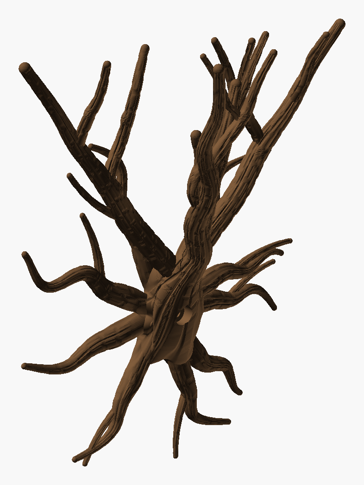
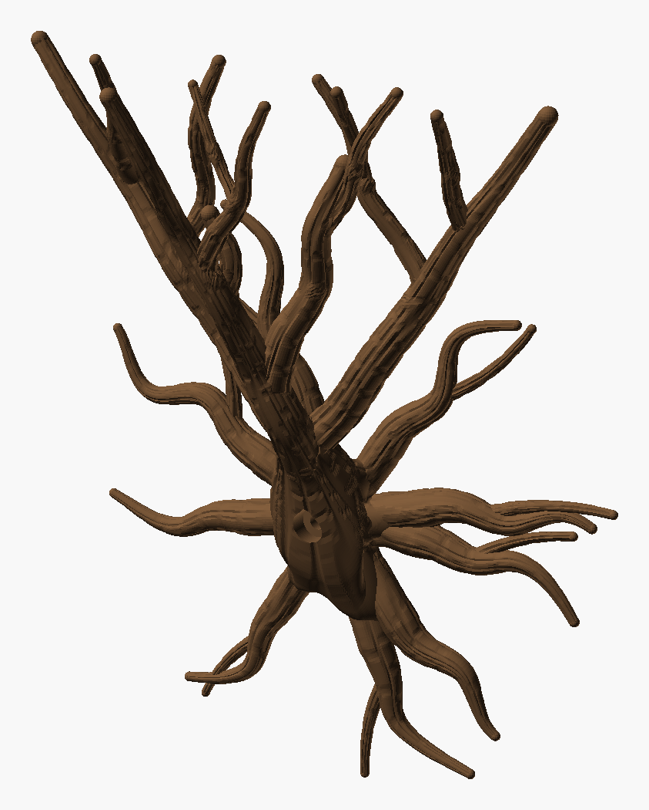
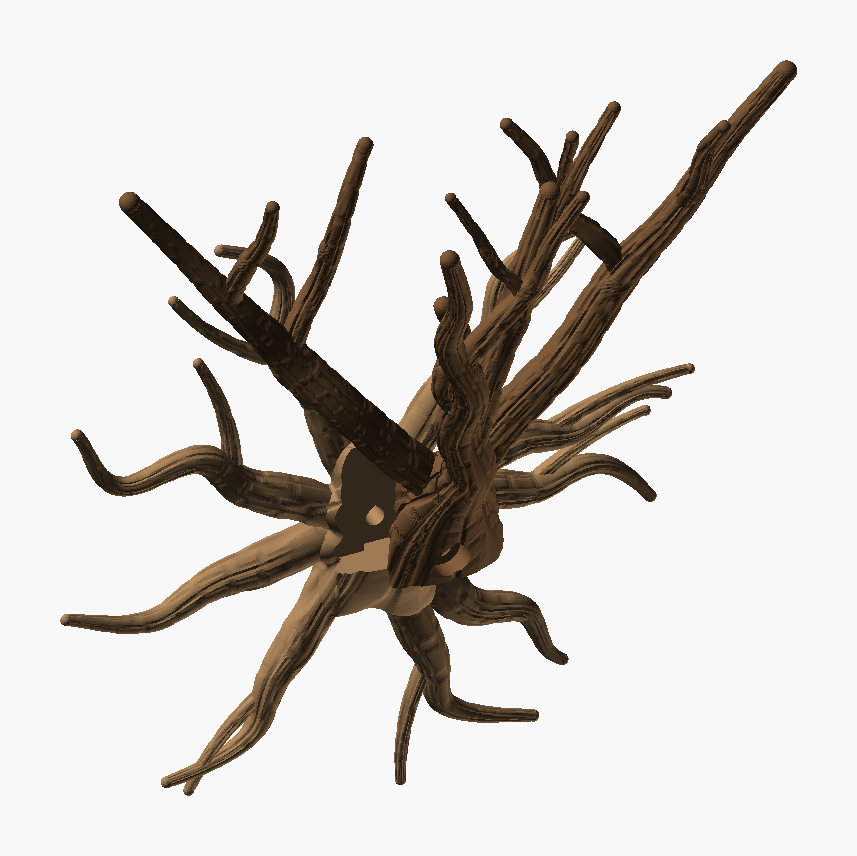

# Wall Climber Tree — iteration 6

[Iteration 5](../iteration_5/README.md) with a stronger zigzag, more sprawl and a strict
3 → 7 → 13 split. The roots (`root_seed` 2), burl, slide and screw are unchanged.


Seen 35° to either side of the front and 20° from above, where the branches separate and the
zigzag, the splits and the crossings read best:

| From the left | From the right |
|---|---|
|  |  |

*The PNGs are OpenSCAD renders, not photos.*

- **Strict 3 → 7 → 13.**
  - The trunk splits into 3: the leader and two limbs.
  - The 3 become 7: two forks off the leader, one off each limb.
  - Six *different* branches of those 7 fork once each, giving 13. Iteration 5 let a thick
    branch fork twice instead.
  - To make that possible, the branches stay a little thicker down the hierarchy: fork shares of
    68 / 66 / 64 %, and tips at 60 % of a branch's start radius.
- **Stronger zigzag.**
  - A bend every 22–38 mm (iteration 5: 30–50), up to 5 per branch.
  - Each swing takes 50 % of the climb the branch can spare (iteration 5: 35 %, up to 22 mm).
  - The swirl gives way, down to 12 % from 25 %. Every branch still climbs at least 45° and
    prints standing.
- **More sprawl.**
  - Longer members: limbs 165–210 mm.
  - Tips spanning 217 mm along the wall (x −104 to +113; iteration 5: 208), up to 100 mm out from
    it, at 166–214 mm up.
  - A 230 mm span was out of reach under the 45° climb: the widest of 15 trees reached 226 mm.
- **More tangle allowed.** Branches that meet may now grow into each other by up to 35 % of the
  thinner one, over up to 24 mm. This crown has 4 meetings (merge ≤ 29 %).
- **Two joint fixes.**
  - **Rings where forks began:** a fork's copy in its parent (the fillet) appeared at full size
    where the fork began, and bulged the parent there even while hidden inside it, leaving a ring
    with a ledge. It now grows in over the fork's first 12 mm. Iteration 5 has these rings too.
  - **Forks thicker than their parent:** a fork was sized from its parent *before* the parent
    thinned for its own forks (the leader loses about 46 % over four). One fork came out thicker
    than the leader where it left it, and its start hung in mid-air below the junction. Every fork
    is now capped at its parent's final radius minus 1 mm, so every branch is thinner than the
    stem it leaves.



| Part | File | Prints | Size on the bed | Slice (H2C, 35 % infill) |
|---|---|---|---|---|
| **Roots** | `Wall_Climber_Tree_Roots.3mf` | flat on its back | 219 × 225 × 24 mm | 1 h 54 min, 55 g |
| **Tree** | `Wall_Climber_Tree.3mf` | standing, as it hangs | 223 × 95 × 186 mm | 3 h 36 min, 68 g |

Both use Cocoa Brown `#6F5034` (Bambu PLA Basic). Neither needs supports. Assembly is unchanged:

1. Hold the roots against the wall.
2. Slide the tree down until its foot sits on the burl's shelf.
3. Drive a 6 mm screw (6 × 50 mm or longer, with a wall plug) through the knot hole under the trunk.

## Checks

| | Tree | Roots |
|---|---|---|
| Topology | 1 shell, 0 / 0 edges | 1 shell, 0 / 0 edges |
| Past 60° | 0.00 % | 0.02 % |
| Bed contact | 4.0 cm² | 102 cm² |
| Floating regions | 0 (`floating_check.py` and Bambu Studio) | 0 |
| Crown | climb ≥ 45.9°, 4 meetings (merge ≤ 29 %), tips ≥ 20.4 mm apart, spanning 217 mm along the wall | — |

- **Fit:** 0 mm³ overlap all along the slide. The parts touch on the joint plane only.
- **The tree stands 186 mm on a 4.0 cm² foot**, so use Bambu Studio's brim.

## Working on it

- **Sketch mode** (`-D sketch=true`): no bark, a few seconds a preview.
- **`Wall_Climber_Tree_inspect.scad`** shows a close-up of any region from any side, all of it or
  one component (burl, crown, trunk). That is how the fork rings were found.
- **`python Wall_Climber_Tree_layout.py 61 120` reproduces this crown.** It was chosen from
  seeds 61–66, about 8 min each, with roughly 30 % of grown trees passing. Its `WHY` counter
  says why candidates were turned down, including which level's fork came up empty.
- **`Wall_Climber_Tree_check.py`** checks the fit, the slide and the floating regions.

Rebuild both parts, then check:

```bash
python tools/build_design.py "art/Sculptures/Wall Climber Tree/Archive/iteration_6/Wall_Climber_Tree.scad" --name "Wall Climber Tree" --out "art/Sculptures/Wall Climber Tree/Archive/iteration_6" --part tree=#6F5034
```

```bash
python tools/build_design.py "art/Sculptures/Wall Climber Tree/Archive/iteration_6/Wall_Climber_Tree.scad" --name "Wall Climber Tree Roots" --out "art/Sculptures/Wall Climber Tree/Archive/iteration_6" --part roots=#6F5034 --define part=\"roots\"
```

```bash
python "art/Sculptures/Wall Climber Tree/Archive/iteration_6/Wall_Climber_Tree_check.py"
```
