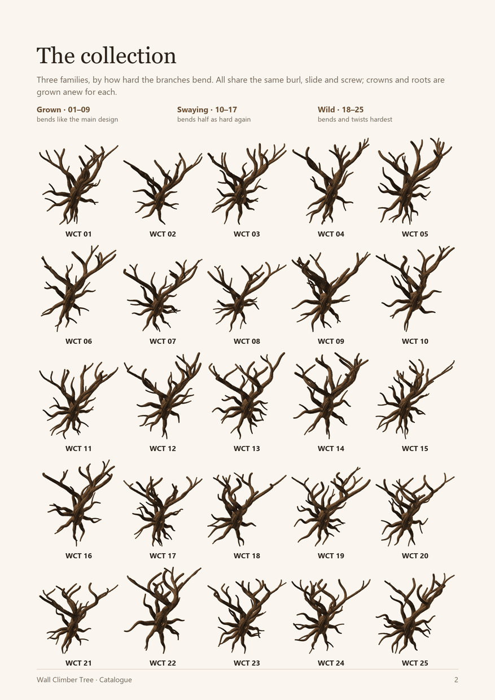

# Wall Climber Tree Catalogue

25 unique, print-verified variations of the [Wall Climber Tree](../README.md) (iteration 7).

- **Each design has its own crown and its own roots.** The burl, slide, screw, bark and print rules
  are the main design's.
- **The crowns grow at three bend strengths,** so part of the catalogue bends much harder than the
  main design.

[**Catalogue_Brochure.pdf**](Catalogue_Brochure.pdf) is the brochure. It has:

- a cover with the main design;
- an index of all 25;
- two designs a page, each seen from the main design's angled-left view, with its numbers;
- a page on printing and hanging.

Its pages are also in `Brochure/` as PNGs.



| Family | Designs | Bend | Main branches turn | Roots |
|---|---|---|---|---|
| **Grown** | WCT_01–09 | ×1.0, as the main design | 115–155° on average | meander 6.5 mm, sweep 20 mm (as the main design) |
| **Swaying** | WCT_10–17 | ×1.5 | 149–181° | meander 7 mm, sweep 23 mm |
| **Wild** | WCT_18–25 | ×2.2 | 183–229° | meander 8 mm, sweep 26 mm |

"Turn" is how far the leader, the limbs and their forks turn over their length, on average.

## What is here

| Path | What it is |
|---|---|
| `Catalogue_Brochure.pdf`, `Brochure/` | the brochure, and its pages as PNGs |
| `Catalogue.png` | the 25 designs, 5 × 5, in the gallery's isometric view |
| `catalogue_results.md` | one row per design: seeds, bend, turn, size, slices, overhang, checks |
| `Designs/WCT_NN/` | for each design: |
| | • `Wall_Climber_WCT_NN.scad` (open it in OpenSCAD) and its crown `Wall_Climber_WCT_NN_layout.scad` |
| | • renders: the assembly (`.png`), the angled view (`_Angled.png`) and the roots (`_Roots.png`) |
| | • `build.log` and `check.log` |
| | • the two `.3mf` Bambu Studio H2C projects (tree and roots), once built locally |
| `catalogue.py` | the whole pipeline (below); its state and every measurement are in `catalogue.json` |

The designs are written from the main design itself (`../Wall_Climber_Tree.scad`) and searched with
its layout script (`../Wall_Climber_Tree_layout.py --bend F`). A change to the main design
therefore carries over on the next `catalogue.py build`.

**3MF files are built locally, not committed.** `.gitignore` keeps `Catalogue/**/*.3mf` out of git.
`python catalogue.py build` rebuilds every design whose 3MFs are missing: about 8 minutes a
design for both parts, five at a time.

## The process

```bash
python catalogue.py all        # everything, resumable; or one stage at a time:
python catalogue.py layouts    # 1. a crown per design: seed 7000 + 10k, 60 grown trees, its tier's --bend
python catalogue.py roots      # 2. root seed 100 + k, 8-11 roots, the tier's meander and sweep
python catalogue.py build      # 3. tree and roots: 3MF + PNG + mesh checks + Bambu Studio slice
python catalogue.py check      # 4. fit and slide (0, 20, 35 mm), floating regions in both parts
python catalogue.py image      # 5. Catalogue.png + catalogue_results.md
python catalogue.py angled     # 6. the angled-left view of each design (bark on)
python catalogue.py brochure   # 7. Catalogue_Brochure.pdf
```

### Pass criteria (all must hold)

| Check | Limit | Where |
|---|---|---|
| Crown climb | ≥ 32° everywhere (growth held at 33.5°) | the layout search |
| Branches that meet | merge ≤ 35 % of the thinner one, over ≤ 24 mm | the layout search |
| Off the wall | no crown surface nearer than 13 mm | the layout search |
| Mesh | 0 boundary / 0 non-manifold edges; past 60° above the first cm < 0.5 % | `tools/mesh_check.py` via `build_design.py` |
| Slice | Bambu Studio slices both H2C projects with no warnings | `build_design.py` |
| Fit | 0 mm³ overlap between tree and roots at slide offsets 0, 20 and 35 mm | `../Wall_Climber_Tree_check.py --scad` |
| Floating | no region of either part starts in mid-air | `tools/floating_check.py` via the check |

## Results of the run (2026-10-24, nightly OpenSCAD / Manifold, Bambu Studio 02.05.00.66)

- **Crowns:** all 25 passed on their first seed.
  - 32–45 of 60 grown trees passed per seed.
  - Climb ≥ 33.5°, merges ≤ 30 %, tips spanning 200–285 mm along the wall.
  - The stronger bend did not lower the pass rate.
- **All 50 parts built and sliced on the H2C with no warnings.**
  - Every part has 0 boundary and 0 non-manifold edges.
  - Trees: 203–291 mm wide, up to 145 mm deep, 178–184 mm tall; 67–78 g, 3 h 27 – 3 h 58 each.
  - Roots: 46–62 g, 1 h 31 – 2 h 8 each.
  - Overhang past 60°: 0.16–0.39 % of the tree (the Wild designs run highest), against a limit
    of 0.5 %.
- **All 25 fit:** 0 mm³ of overlap at every slide offset, and no floating regions in either part.
- **Every part is one solid body.** WCT_05, 09 and 16 (tree) and WCT_07 (roots) carry one sealed
  internal void each where two members merge: 0.07 mm³ at most, which the slicer fills.
- **One fix came out of the catalogue.** The first run left one floating region at a twig's tip on
  WCT_07, 18 and 21. The dome on a branch end must sink below the bark's fissures, which on a twig
  are deeper than the fixed 0.45 mm inset allowed. The inset now follows the tube's own bark
  depth, in the main design too, and everything was rebuilt.

## Making more

Raise `N`, or add a tier to `TIERS`, in `catalogue.py`, then run `python catalogue.py all`.
Finished designs are kept, and new ones get seeds of their own.
