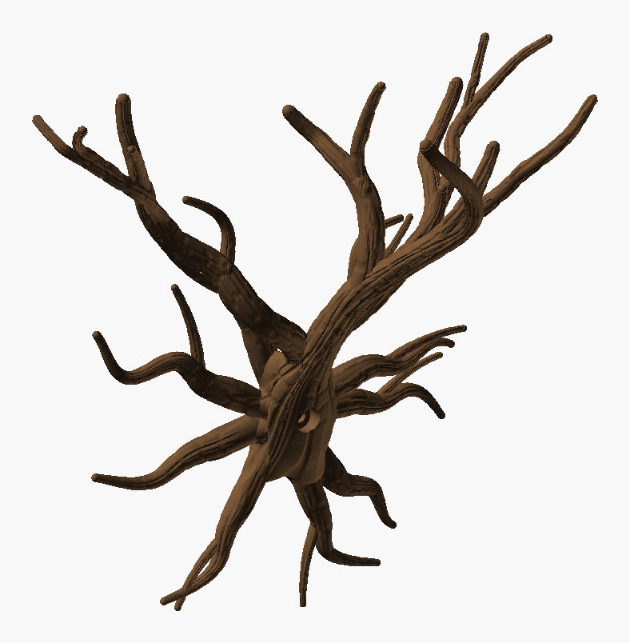
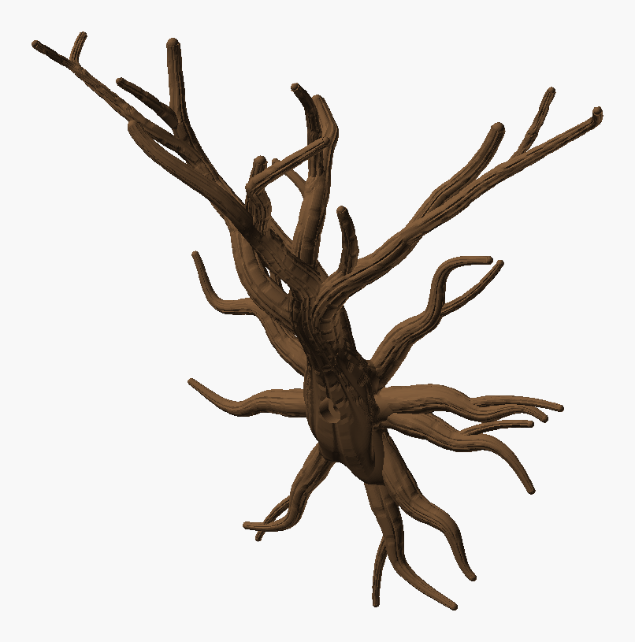
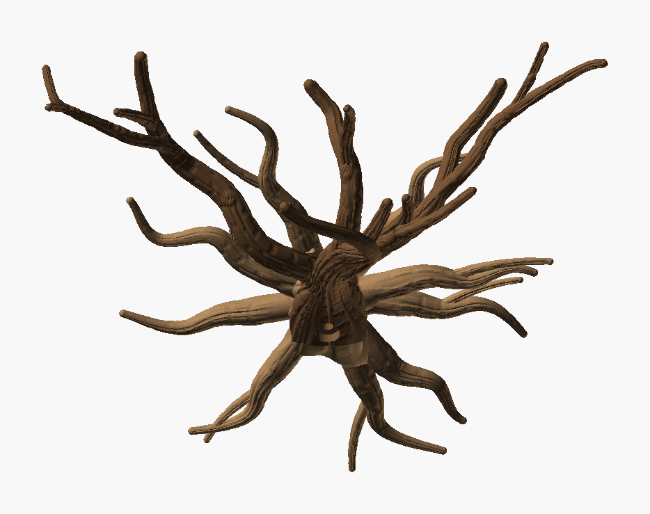

# Wall Climber Tree

A tree that grows out of the wall, for climbing and sprawling plants, in two parts: a roots plate
that prints flat, and a tree that prints standing, slides onto the plate and clamps it to the wall
with one 6 mm screw. This is iteration 7; iterations 1–6 are in [Archive](Archive/README.md), and
25 variations are in the [Catalogue](Catalogue/README.md).

[Iteration 6](Archive/iteration_6/README.md) with **bending branches** that grow rather than aim, and
print at the 60° overhang limit. The roots (`root_seed` 2), burl, slide and screw are unchanged.


Seen 35° to either side of the front and 20° from above:

| From the left | From the right |
|---|---|
|  |  |

*The PNGs are OpenSCAD renders, not photos.*

- **Branches are grown, not aimed.**
  - Up to iteration 6, each branch was a curve from its start to a tip chosen in advance.
  - Now each branch grows a millimetre at a time, and its heading turns as it goes.
  - The turn happens in a bend plane that rotates round the branch. A slow rotation bends the
    branch in an arc; a fast one winds it into a loose helix. A gentle wiggle sits on top.
  - Where a branch ends up is wherever the growth takes it.
- **Main branches bend hardest.**
  - Curvature by level: 1/80–1/36 per mm for the leader and limbs, 1/90–1/42 for their forks,
    1/140–1/65 for the twigs.
  - The limbs and their forks turn 158° on average over their length (leader 189°, limbs
    207° and 201°).
  - Choosing forks by the spread of their tips alone picked the straightest limb every time. The
    choice now also scores how far a fork turns.
- **Any direction, back towards the wall too.**
  - A fork leans towards a drawn direction only while it peels off its parent (its first 25 %).
    After that it bends freely.
  - A branch may head towards the wall while it has room. The closer it gets, the less it may head
    in (1 unit per 20 mm left), so it turns to run along the wall rather than cross it.
  - No crown surface comes nearer than 13 mm to the wall (the split is at 12 mm).
  - 237 mm of this crown's main branches head back towards the wall.
  - The bed edge (±145 mm) and the reach out from the wall (150 mm) steer branches the same way.
- **Printed to 60°.**
  - The climb limit drops from 45° to 30°, the house rule's 60° from vertical.
  - Growth is held at ≥ 33.5° and checked at ≥ 32°, which leaves a margin for the bark.
  - Within 16° of that limit a branch is pulled upwards, so it arcs up off the limit instead of
    running straight along it.
  - The tree has 0.24 % of its surface past 60° (iteration 6: 0.00 %; the limit is 0.5 %).
- **Dome tips instead of spheres.**
  - At a 33° climb, a whole sphere on a branch end hangs r(1 − cos α) below the end ring, with
    nothing under it. `floating_check.py` found 11 such regions at two tips.
  - The tips are now domes facing along the branch, sunk below the deepest bark fissure at the
    branch's end (its own bark depth, up to about 0.5 mm on a twig, plus 0.1 mm), so their edge
    does not poke out of the fissures. A fixed 0.45 mm inset still left one such region on three
    catalogue twigs.
- **Wider:** the tips span 281 mm along the wall (x −139 to +142), at 160–212 mm up.



| Part | File | Prints | Size on the bed | Slice (H2C, 35 % infill) |
|---|---|---|---|---|
| **Roots** | `Wall_Climber_Tree_Roots.3mf` | flat on its back | 219 × 225 × 24 mm | 1 h 54 min, 55 g |
| **Tree** | `Wall_Climber_Tree.3mf` | standing, as it hangs | 285 × 142 × 183 mm | 3 h 35 min, 69 g |

Both use Cocoa Brown `#6F5034` (Bambu PLA Basic). Neither needs supports. The tree is 285 mm wide,
so it needs the H2C's full bed. Assembly is unchanged:

1. Hold the roots against the wall.
2. Slide the tree down until its foot sits on the burl's shelf.
3. Drive a 6 mm screw (6 × 50 mm or longer, with a wall plug) through the knot hole under the trunk.

## Checks

| | Tree | Roots |
|---|---|---|
| Topology | 1 shell, 0 / 0 edges | 1 shell, 0 / 0 edges |
| Past 60° | 0.24 % | 0.02 % |
| Bed contact | 4.0 cm² | 102 cm² |
| Floating regions | 0 (`floating_check.py` and Bambu Studio) | 0 |
| Crown | climb ≥ 33.4°, main branches turn 158° on average, 1 meeting (merge ≤ 18 %), tips ≥ 29.9 mm apart | — |

- **Fit:** 0 mm³ overlap at slide offsets of 0, 10, 20 and 35 mm. The parts touch only on the joint plane.
- **The tree stands 183 mm on a 4.0 cm² foot** and reaches out 142 mm each side, so use Bambu
  Studio's brim.

## Working on it

- **`python Wall_Climber_Tree_layout.py 92 80` reproduces this crown.**
  - It was chosen from seeds 91–98, compared on a contact sheet.
  - About 60 % of grown trees pass, at about 1.5 s a tree, so a seed of 80 takes about 2 min.
  - The `WHY` counter says why candidates were turned down.
  - The curvature (`BEND`), the twist (`TWIST`) and how hard the wall pushes back (`WALL_PULL`)
    are at the top of the script.
- **Sketch mode** (`-D sketch=true`): no bark, a few seconds a preview.
- **`Wall_Climber_Tree_inspect.scad`** shows a close-up of any region.
- **`Wall_Climber_Tree_check.py`** checks the fit, the slide and the floating regions.

Rebuild both parts, then check:

```bash
python tools/build_design.py "art/Sculptures/Wall Climber Tree/Wall_Climber_Tree.scad" --name "Wall Climber Tree" --out "art/Sculptures/Wall Climber Tree" --part tree=#6F5034
```

```bash
python tools/build_design.py "art/Sculptures/Wall Climber Tree/Wall_Climber_Tree.scad" --name "Wall Climber Tree Roots" --out "art/Sculptures/Wall Climber Tree" --part roots=#6F5034 --define part=\"roots\"
```

```bash
python "art/Sculptures/Wall Climber Tree/Wall_Climber_Tree_check.py"
```
