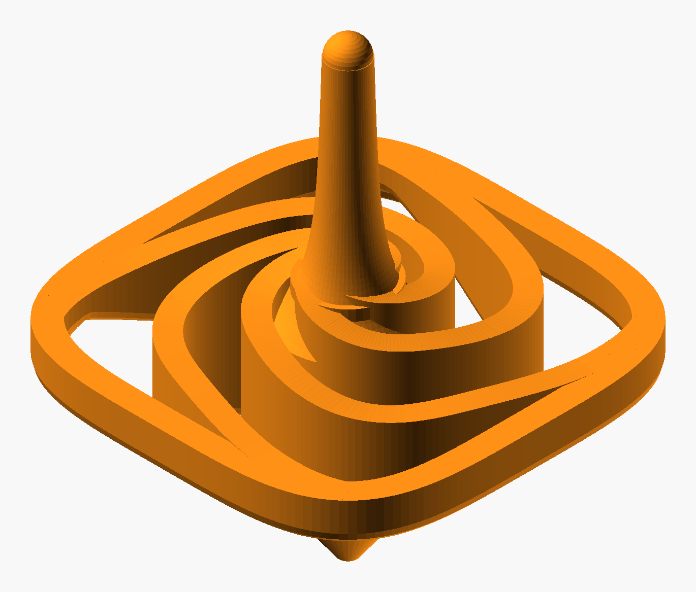

# Swirl Spinning Top

A small spinning top, 50 mm tall and 42 mm across, printed in one piece. Its body is four spiral
ribbons. Each one starts at a corner of a rounded-square frame and winds in to the hub, getting
rounder as it goes. Their lower edges taper down to the point in a cone. Their top edges rise
towards the middle and flow into a slender stem for twirling.



*(A render, not a photo.)*

## Printing: one piece, with supports

`Swirl_Spinning_Top.3mf` is a Bambu Studio project: H2C, 0.20 mm Standard, 35 % infill, Bambu PLA
Basic **Pumpkin Orange**. The top stands upright on its point. The point has a 0.4 mm flat
(`tip_flat`) to stand on. Turn on:

- **supports**: tree supports, auto. The frame and the lower edges of the ribbons hang in the air
  (about 6 % of the surface is past 60°).
- **a brim**, so the small flat at the point stays on the bed.

Mesh checks: closed, one shell. About 10 g at 100 % solid. It has not been sliced with Bambu Studio
yet: that check was skipped in the build environment.

## Customizer

- `total_h`, `frame_w`, `body_h`: overall size
- `arms`, `turns`, `wind_bias`, `squareness`, `handed`: the swirl. With 4 arms, keep `turns` around
  0.8, or the gaps between ribbons get too narrow
- `top_rise`, `rise_power`: how the ribbon tops climb into the stem
- `ribbon_t`, `frame_t`, `frame_h`: wall sizes. Keep them at 2.4 mm or more

Change any of them, then rebuild with:

```bash
python tools/build_design.py "art/Toys/Swirl Spinning Top/Swirl_Spinning_Top.scad" --name "Swirl Spinning Top" \
    --out "art/Toys/Swirl Spinning Top" --part top=#FF9016 --check-args "--max-overhang 100"
```
