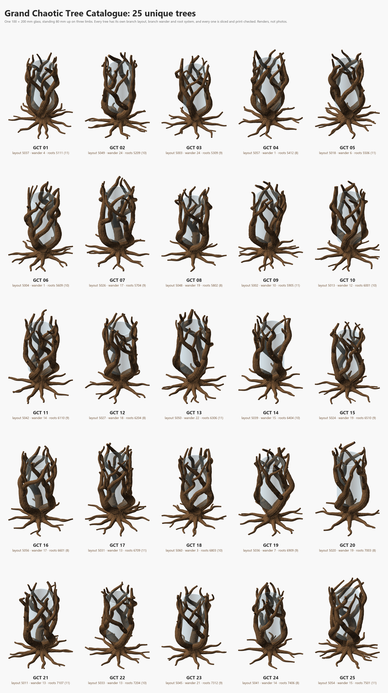

# Grand Chaotic Tree Catalogue

Unique, print-verified variations of the **Grand Chaotic Tree**: a big glass (100 × 200 mm, foot
rounded 2 mm) standing 80 mm up on three limbs of a buttressed 3 → 7 → 13 tree, 1 mm clearance all
round, 320 mm tall with roots over 310 mm of ground, for the Bambu Lab H2C. Every catalogue tree has
its **own branch layout, its own branch wander and its own root system**; the glass, its seat and
clearance, trunk, bark, height and print rules are the original's.

The method is the one built for the [Wild Chalice Tree Catalogue](../Wild%20Chalice%20Tree%20Catalogue/README.md)
(read it for the background); this catalogue applies it to the Grand tree's glass and geometry.

[](Catalogue.png)

## What is here

| Path | What it is |
|---|---|
| `Catalogue.png` | the 25 designs, 5 × 5 (renders, not photos) |
| `catalogue_results.md` | one row per design: seeds, size, branch merge, climb, seat, slice time and mass, checks |
| `Designs/GCT_NN/` | `Grand_Chaotic_GCT_NN.scad` (open it in OpenSCAD), `.3mf` (Bambu Studio H2C project, Cocoa Brown PLA Basic, 35 % infill), `.png`, `build.log` |
| `catalogue.py` | the whole pipeline (below); its state and every measurement are in `catalogue.json` |
| `Grand_Chaotic_Tree_template.scad` | the design every catalogue tree is written from: the original with seeded roots |
| `Grand_Chaotic_Tree_layout.py` | the branch-layout search (unchanged from the original) |
| `search/` | raw search output: one file per layout seed, candidate `.scad`s, `run.log` |
| `Reference/` | the original design: `.scad`, `.3mf`, `.png` and the photo of the print |

## The process

```bash
python catalogue.py all 25      # everything, resumable; or one stage at a time:
python catalogue.py layouts     # 1. 60 layout searches (seeds 5001-5060), 4000 random trees each
python catalogue.py branches 25 # 2. a wander seed (1-24) for each layout, best layouts first, until 25 pass
python catalogue.py roots 25    # 3. root count (8-11) and root seed per design
python catalogue.py build       # 4. tools/build_design.py: 3MF + PNG + mesh checks + Bambu Studio slice
python catalogue.py check       # 5. glass clearance and seat, one solid body
python catalogue.py image       # 6. Catalogue.png + catalogue_results.md
```

| Input | What it decides | Chosen by |
|---|---|---|
| `limb_table`, `fork_table` | the 3 limbs and 10 forks | `Grand_Chaotic_Tree_layout.py SEED 4000`: smallest empty sector round the glass, a tripod seat (< 128°), 8–16 well-spaced meetings. Its turn rates are per glass height and already scaled for the 200 mm glass (guide §16.2) |
| `wander_seed` | how every branch wanders, lifts off and flicks at the tip | stage 2, seeds 1–24 per layout (the original's 44 was the best of 48) |
| `root_seed` | every root's angle, length, sweep, meander (phase, wavelength, amplitude), side roots and buttress; the trunk knots and bark pattern | stage 3, 12 seeds per design from a range of its own, `5000 + 100·k + 1 ...`, clear of every earlier round |
| `root_count` | 8, 9, 10 or 11 roots | spread over the catalogue |

### Pass criteria (all must hold)

| Check | Limit | Where |
|---|---|---|
| Merge where two branches meet | ≤ 30 % of the thinner one's thickness | `tools/member_clearance.py --floor 80` |
| Branch climb | ≥ 30° | the design's echo |
| Tightest centreline bend | ≥ 1.25 × the tube radius, branches and roots | `catalogue.py` |
| End caps | under 320 mm | `tools/cap_height.py --limit 320` |
| Roots | inside the 310 mm spread (+2 mm) | `catalogue.py` |
| Mesh | 0 boundary / 0 non-manifold edges; past 60° above the first cm < 0.5 % | `tools/mesh_check.py` via `build_design.py` |
| Glass | nothing inside the glass **or its 1 mm clearance** (a 102 mm bore from 80 mm up, foot rounded 3 mm); pads under the glass with no gap of 180° or more | `mesh_check.py --bore-r 51 --floor-h 80 --foot-r 3`, the check the original was built to |
| Slice | Bambu Studio slices the H2C project with no warnings | `build_design.py` |
| One body | one shell of real volume; other shells may only be internal voids or zero-volume slivers | `catalogue.py check` |

**Calibration:** the original tree, run through the same stage-2 and stage-3 checks from the
template, gives what guide §16 records for it: 11 meetings, merge ≤ 18 %, climb ≥ 31°, tightest
bend 1.36 ×, roots reaching 150 mm.

## Results of the run (2026-10-17, nightly OpenSCAD / Manifold, Bambu Studio 02.05.00.66)

- 60 layout searches; the best 42 were wander-searched and **27 passed** (64 %, the same rate as
  the Wild Chalice catalogue). The 25 best became GCT_01–25. All 25 root systems passed at the
  first try (root bends ≥ 2.4 × the radius, reach ≤ 150.4 mm of the 155 allowed).
- Branches: merge ≤ 26 %, climb ≥ 30°, tightest bend ≥ 1.27 × the radius.
- All 25 built with 0/0 edges and sliced on the H2C **with no warnings**: 317.2–319.7 mm tall,
  footprints up to 290 × 286 mm (bed 325 × 320), **464–501 g, 14 h 53 – 16 h 27** each. About
  4 minutes per build, five at a time.
- Glass: nothing inside the glass or its 1 mm clearance (closest material exactly on the clearance
  line, where the wood is pressed); the glass stands on **2.2–3.3 cm²** of pads (the original 2.9),
  largest gap between them ≤ 112°.
- Every tree is one solid body. Up to 4 sealed internal voids per tree where merged branches
  overlap, 0.26 mm³ at most in total; the slicer fills them.

## How it differs from the Wild Chalice catalogue

- **The glass stands on the limbs**, it is not cupped. Its side is straight with a 2 mm rounded
  foot, so `mesh_check.py --foot-r` measures the fit exactly and the Chalice's curved-base seat
  script is not needed. The 1 mm clearance is checked as part of the glass.
- **Bigger and taller:** 320 mm limit (the H2C prints 325), roots to 310 mm, branches 12.5 mm.
  Every path evaluation takes about 20 s (12 s on the Chalice), and every build longer.
- **No sketch mode** in this design; the build renders the bark directly.
- Root seeds start at 5001: the Wander round used 101–512 and the Chalice catalogue 1101–3512.

## Making more

Add seeds to `LAYOUT_SEEDS` in `catalogue.py` and run `python catalogue.py all 40`: finished designs
are kept and new ones numbered on. To change the glass, edit `glass_d` / `glass_h` in the template,
update `MESH_CHECK`, `TOTAL_H` and `LIFT` in `catalogue.py`, and start a fresh `catalogue.json`.
