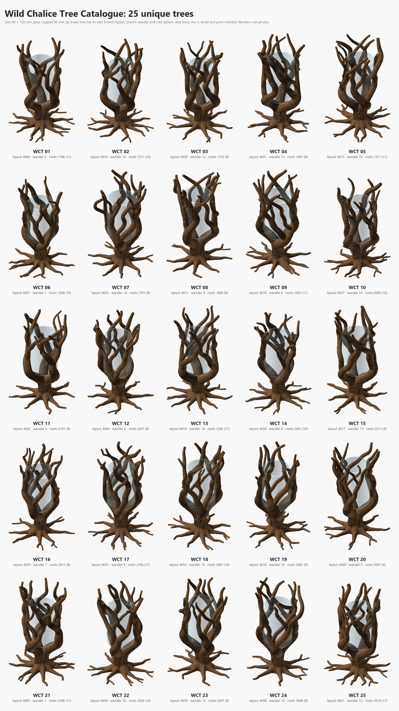

# Wild Chalice Tree Catalogue

Unique, print-verified variations of the **Wild Chalice Tree**: a small vase glass (80 × 130 mm,
its side curving in over the bottom 20 mm to a 50 mm bottom) cupped 85 mm up in a 3 → 7 → 13 tree,
269 mm tall, for the Bambu Lab H2C. Every catalogue tree has its **own branch layout, its own branch
wander and its own root system**; everything else (glass, seat, trunk, bark, height, print rules)
is the original's.

[](Catalogue.png)

## What is here

| Path | What it is |
|---|---|
| `Catalogue.png` | the 25 designs, 5 × 5 (renders, not photos) |
| `catalogue_results.md` | one row per design: seeds, size, branch merge, climb, seat, slice time and mass, checks |
| `Designs/WCT_NN/` | `Wild_Chalice_WCT_NN.scad` (open it in OpenSCAD), `.3mf` (Bambu Studio project, Cocoa Brown PLA Basic, 35 % infill), `.png`, `build.log` |
| `catalogue.py` | the whole pipeline (below); its state and every measurement are in `catalogue.json` |
| `Wild_Chalice_Tree_template.scad` | the design every catalogue tree is written from (the original with seeded roots) |
| `Wild_Chalice_Tree_layout.py` | the branch-layout search (unchanged from the original) |
| `Wild_Chalice_Tree_seat_check.py` | glass fit and seat on the real curved base (unchanged) |
| `search/` | raw search output: one file per layout seed, candidate `.scad`s, `run.log` |
| `Reference/` | the original design (`.scad`, `.3mf`, `.png`, notes) and the two rounds that led here: `Various/` (5 new branch layouts) and `Wander/` (5 trees whose roots wander too), with their scripts and overviews. Reference copies: run the scripts from their original folders under `../Wild Chalice Tree/` |

## The process

```bash
python catalogue.py all 25      # everything, resumable; or one stage at a time:
python catalogue.py layouts     # 1. 60 layout searches, 4000 random trees each, 15 at once
python catalogue.py branches 25 # 2. a wander seed for each layout, best layouts first, until 25 pass
python catalogue.py roots 25    # 3. root count (8-11) and root seed per design
python catalogue.py build       # 4. tools/build_design.py: 3MF + PNG + mesh checks + Bambu Studio slice
python catalogue.py check       # 5. seat on the curved glass base; one solid body
python catalogue.py image       # 6. Catalogue.png + catalogue_results.md
```

The design has five free inputs; everything else is derived from the glass:

| Input | What it decides | Chosen by |
|---|---|---|
| `limb_table`, `fork_table` | the 3 limbs and 10 forks: angles, turn rates, reversals, fork heights, shares, lean, meander | `Wild_Chalice_Tree_layout.py SEED 4000`: the random tree with the smallest empty sector round the glass, a steady three-point seat (< 128°) and 8–16 well-spaced meetings |
| `wander_seed` | irregular wander of every branch along the glass, lift-off and the tip flick | stage 2, seeds 1–16 per layout |
| `root_seed` | every root's angle, length, sweep, meander (phase, wavelength, amplitude), side roots, buttress reach; the trunk knots and the bark pattern | stage 3, 12 seeds per design from a range of its own (`1000 + 100·k + 1 ...`, clear of the 101–512 the Wander round used), so no two trees share a root system |
| `root_count` | 8, 9, 10 or 11 roots | spread over the catalogue (`[8, 9, 10, 11][3k mod 4]`) |

### Pass criteria (all must hold)

| Check | Limit | Where |
|---|---|---|
| Merge where two branches meet | ≤ 30 % of the thinner one's thickness | `tools/member_clearance.py --floor 65` (below 65 mm the limbs are still forks of each other) |
| Branch climb | ≥ 30° everywhere above half the lift | the design's echo (the 60° overhang rule on a tube) |
| Tightest centreline bend | ≥ 1.25 × the tube radius, branches **and** roots | `catalogue.py` (a tighter bend folds the tube into itself) |
| End caps | under the 269 mm height limit | `tools/cap_height.py --limit 269` |
| Roots | inside the 208 mm root spread (+2 mm) | `catalogue.py` |
| Mesh | 0 boundary / 0 non-manifold edges; past 60° above the first cm < 0.5 % | `tools/mesh_check.py` via `build_design.py` |
| Slice | Bambu Studio slices the H2C project with **no warnings** (no floating regions) | `build_design.py` |
| Glass | nothing inside the glass; pads on the curved base, largest gap between them < 180° | `Wild_Chalice_Tree_seat_check.py` |
| One body | exactly one shell of positive volume (extra shells may only be internal voids) | `catalogue.py check` |

## Insights from the design process

**From the Wild Chalice Tree itself** (`Reference/Wild_Chalice_Tree_notes.md`, guide §20):

- The glass sits *into* the limbs, like an egg in a cup. The hug line is a true offset of the glass
  profile (an arc of radius R + d about the foot's centre), and it stops at 45° (`cup_max`) and runs
  on along its tangent, so the limbs never pass under the glass and never bend tighter than ~1.5×
  their radius.
- Zero clearance: wood is pressed flat onto the glass (`press`), never cut by a bore. If a printed
  glass sits too high, set `clearance` 0.2–0.3 and rebuild.
- Trunk, buttresses and root bases are one lofted skin, so the joins don't show.

**From the Various round (new branch layouts, same roots):**

- A good layout score is **not** enough. Wander changes where branches meet, so the wander seed is a
  search dimension of its own. Roughly half the well-scored layouts fail with *every* wander seed
  (e.g. layout 733 climbed 17° with a 52 mm arch whatever the seed). Drop those; don't tune them.
- Score each (layout, wander) pair from the `part="paths"` echo: ~12 s per evaluation on the nightly
  build, instead of a full render. Only pairs that pass go on to be built.

**From the Wander round (roots that wander too):**

- The root system was the same on every earlier tree: every per-root random number came from
  `rnd(i, k)` with fixed seeds. `rr(i, k) = rnd(i + 19·root_seed, k)` makes it a free input. The
  meander amplitude was made per-root as well (0.7–1.3 × `root_meander`), and the angle jitter widened
  from ±10° to ±13°.
- Roots are safe to randomise: every root seed tried passed (bends ≥ 1.7 × the root radius, inside the
  spread). The checks that do matter are the branch ones.
- Merged branches can trap **sub-millimetre internal voids** (0.001–0.03 mm³) where they overlap.
  They show up as extra shells with negative volume. The tree is still one solid; the slicer fills
  them. A shell with positive volume would be a loose piece, and fails the check.
- Every tree came out at ~267.5 mm and 240–250 g, about 9 h 10 – 9 h 30 on the H2C at 35 % infill.
  The seat measured 9.1–9.6 cm² of pads on the curve, with the largest gap 90–103°.

**From the catalogue run (2026-10-17, nightly OpenSCAD / Manifold, Bambu Studio 02.05.00.66):**

- 60 layout searches; the best 42 were wander-searched and **27 passed** (64 %). The 25 best of those
  became WCT_01–25. All 25 root systems passed at the first try (root bends ≥ 1.61 × the radius).
- All 25 built with 0/0 edges, sliced on the H2C **with no warnings**, and passed the seat check
  (9.0–10.5 cm² of pads on the curved base, largest gap ≤ 101°): 238–259 g, 9 h 07 – 10 h 02 each.
  Builds took about 4 minutes each, five at a time (98 build-minutes in all).
- **Give each round its own root-seed range.** The first catalogue run drew design k's roots from
  `100·k + 1 ...`, the same range the Wander round had used, and WCT_02 and WCT_03 got Wander 2's and
  3's root systems back. The ranges now start at 1000.
- **"Loose piece" means real volume.** WCT_10 has a flat 4-vertex shell of zero volume where two
  branches merge: a degenerate sliver, not wood. A shell counts as a body only above 0.01 mm³; the
  internal voids measured up to 0.28 mm³ in total on one tree.

## Making more

Add seeds to `LAYOUT_SEEDS` in `catalogue.py` and run `python catalogue.py all 40` (or any number):
finished designs are kept, new ones are numbered on. To change the glass, edit `glass_d`/`glass_h`
in `Wild_Chalice_Tree_template.scad` and start a fresh `catalogue.json`: every check depends on it.

Requires OpenSCAD (the nightly, with Manifold: about a minute per full render), Python 3 with
`numpy`, `scipy` and `Pillow`, and Bambu Studio for the slice check.
